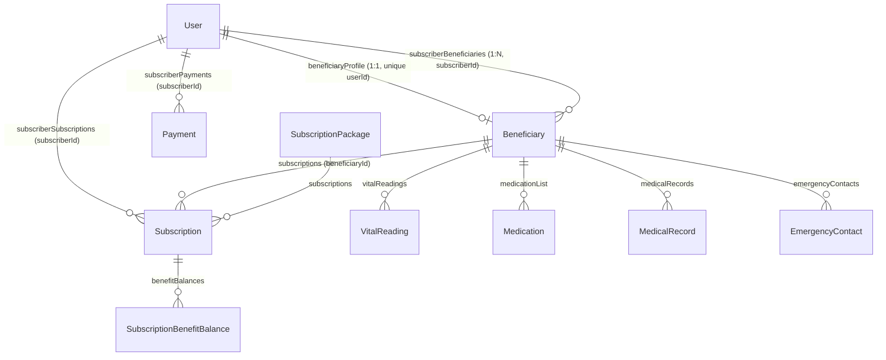
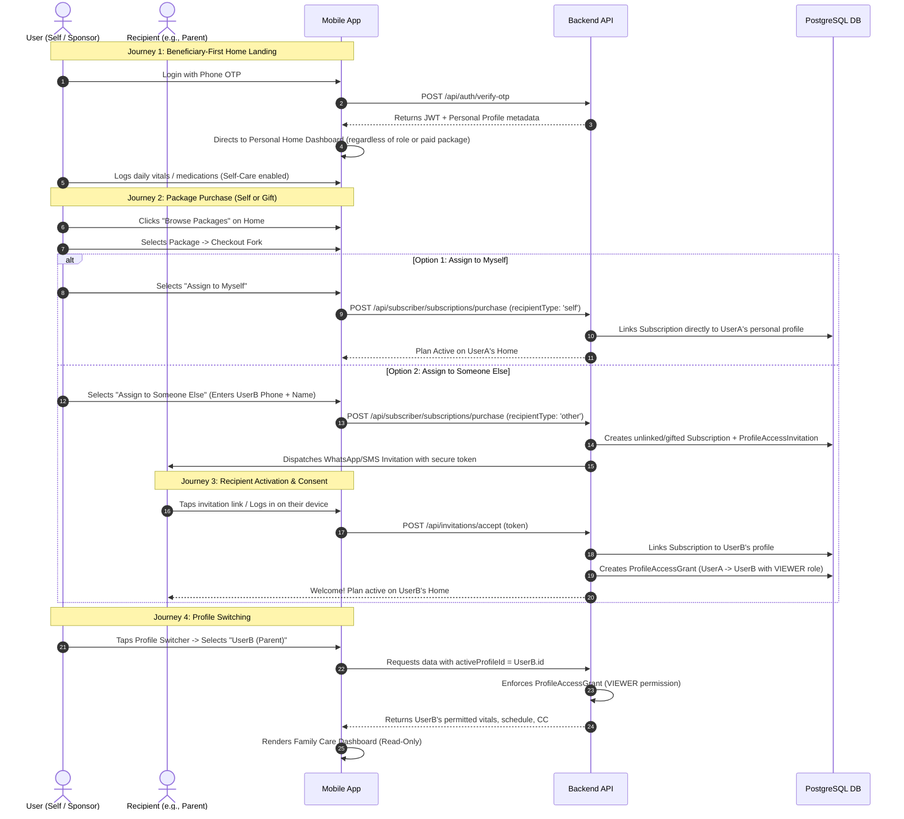
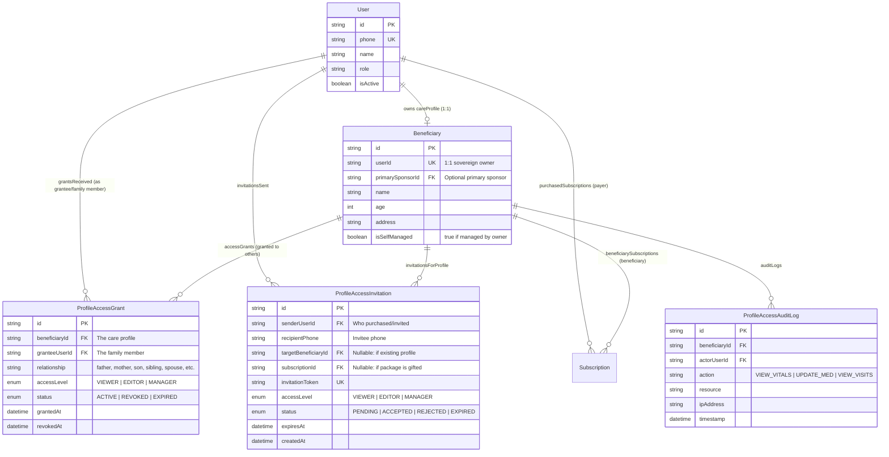
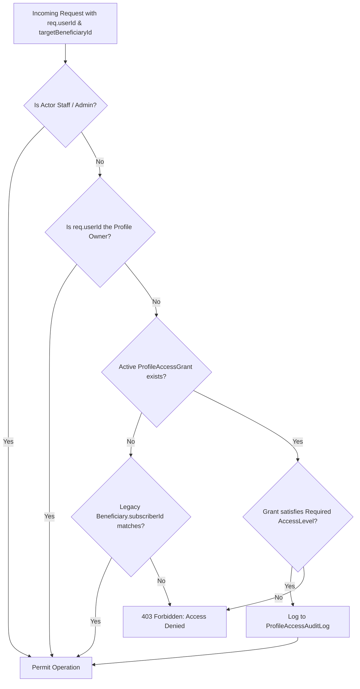
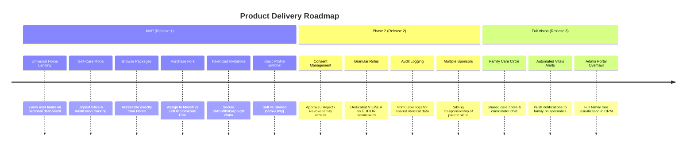
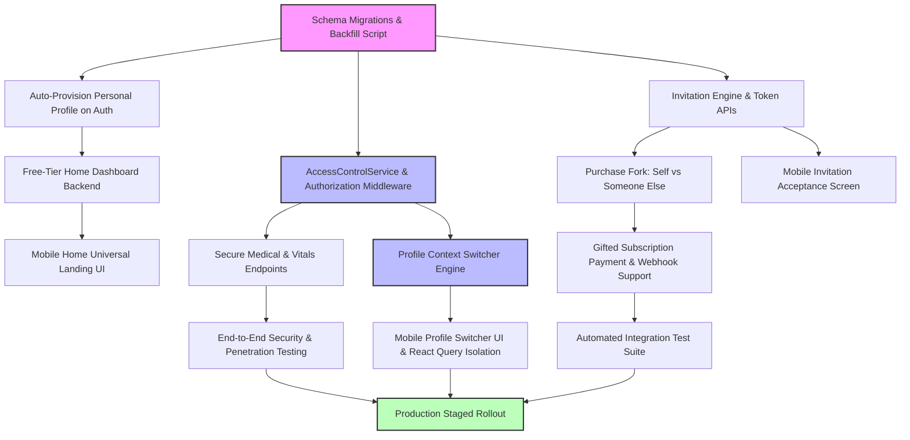

# Mai-HoonNa — Beneficiary-First, Self-Care & Family-Care Architecture & Complexity Assessment

> **Document Type:** Principal Architecture & Technical Project Assessment  
> **Target System:** Mai-HoonNa Monorepo (`apps/api`, `apps/mobile-app`, `apps/admin-backend`, `apps/admin-frontend`, `packages/database`, `packages/notifications`)  
> **Status:** Assessment & Architectural Proposal (Read-Only Analysis — No System Code or Data Modified)  
> **Target Artifact:** `docs/beneficiary-first-complexity-assessment.md`  

---

## 1. Executive Summary

### 1.1 Executive Overview
Mai-HoonNa operates currently under a **Subscriber-First Elder-Care Hierarchy**. A purchaser ("Subscriber") creates an account, chooses an elder-care package, inputs their parent's or relative's demographic, medical, and emergency contact details during checkout, executes payment, and manages care services. While this functions well for adult children sponsoring care for aging parents, it creates friction when individuals wish to:
1. Use Mai-HoonNa directly for their own health monitoring and self-care (without being forced through an elder-care proxy flow or paying upfront).
2. Purchase a care package for themselves directly.
3. Purchase care packages for multiple family members independently without account collisions.
4. Share access to an elderly parent's care dashboard across multiple siblings or caregivers with explicit, consent-governed view vs. edit permissions.
5. Manage care for family members who maintain their own sovereign logins and data privacy.

This report evaluates the technical complexity, implementation effort, database schema changes, API contracts, mobile UX changes, security safeguards, and migration strategy required to transform Mai-HoonNa into a **Beneficiary-First, Self-Care, and Family-Care Platform**.

### 1.2 Core Architectural Shift
The platform will transition from a **rigid 1:1 hierarchical model** to a **relationship-driven sovereign account model**:

```
[CURRENT MODEL: Rigid 1:1 Hierarchy]
User (Subscriber) ──(1:N)──> Beneficiary (userId unique, subscriberId FK) ──(1:N)──> Subscription
* Beneficiary profile cannot exist without a subscriber.
* Only 1 subscriber can ever be associated with a beneficiary.
* Login routes to dashboard by static UserRole.

[PROPOSED MODEL: Sovereign Accounts + Consent-Based Access Grants]
User (Universal Sovereign Identity) ──(1:1)──> Personal Care Profile (Beneficiary Profile)
      │                                                ▲
      ├───(Access Grants: View/Edit)───────────────────┤ (Profiles shared with me)
      ├───(Purchases / Sponsorship)────────────────────┼──> Subscription (Linked to Care Profile)
      └───(Invitations / Consent Requests)─────────────┘
```

### 1.3 Key Findings & Strategic Verdict
- **Feasibility:** **High**. The current codebase already has preliminary building blocks, including a dual-role detection and role-switch mechanism in [`apps/api/app/services/auth/auth_service.ts`](file:///c:/Users/91930/OneDrive/Desktop/Mai-Hoonaa/apps/api/app/services/auth/auth_service.ts#L168-L209) and unlinked subscription handling in [`apps/api/app/api/subscriber/subscriptions.routes.ts`](file:///c:/Users/91930/OneDrive/Desktop/Mai-Hoonaa/apps/api/app/api/subscriber/subscriptions.routes.ts#L420-L460).
- **Core Architectural Barrier:** In [`packages/database/prisma/schema.prisma`](file:///c:/Users/91930/OneDrive/Desktop/Mai-Hoonaa/packages/database/prisma/schema.prisma#L240-L243), `Beneficiary.userId` has `@unique` and `Beneficiary.subscriberId` is a single foreign key. Furthermore, [`apps/api/app/services/subscriber/beneficiary_service.ts`](file:///c:/Users/91930/OneDrive/Desktop/Mai-Hoonaa/apps/api/app/services/subscriber/beneficiary_service.ts#L100-L119) actively overwrites `subscriberId` if a phone number already exists, and several core routes ([`apps/api/app/api/subscriber/vitals.routes.ts`](file:///c:/Users/91930/OneDrive/Desktop/Mai-Hoonaa/apps/api/app/api/subscriber/vitals.routes.ts#L19-L28)) enforce authorization strictly via `beneficiary.subscriberId === req.userId`.
- **Security Vulnerabilities Identified in Current Codebase:** 
  1. [`apps/api/app/api/shared/medications.routes.ts`](file:///c:/Users/91930/OneDrive/Desktop/Mai-Hoonaa/apps/api/app/api/shared/medications.routes.ts#L8-L11) accepts any `beneficiaryId` without checking if `req.userId` has any relationship to that beneficiary (IDOR).
  2. Mobile React Query cache keys in [`apps/mobile-app/app/(beneficiary)/index.tsx`](file:///c:/Users/91930/OneDrive/Desktop/Mai-Hoonaa/apps/mobile-app/app/%28beneficiary%29/index.tsx#L157) hardcode `MOCK_BENEFICIARY_ID`, risking cross-context data leakage.
- **Estimated Effort:**
  - **MVP Scope:** **24 – 32 person-days** (~4 to 5 calendar weeks for a team of 1 Senior Backend Engineer, 1 Senior React Native Engineer, 1 QA Engineer).
  - **Production-Ready Release:** **42 – 54 person-days** (~7 to 9 calendar weeks, including full audit logging, tokenized invitation redemption, and backward compatibility tests).
  - **Full Vision:** **75 – 95 person-days** (~14 to 17 calendar weeks, covering multi-tier RBAC, deep family care coordination, notification center controls, and admin portal upgrades).

---

## 2. Verified Current Architecture

### 2.1 Workspace & Monorepo Topology
The repository is an npm monorepo structured as follows:

| Directory | Type / Framework | Purpose | Runtime / Tooling |
|---|---|---|---|
| [`apps/api`](file:///c:/Users/91930/OneDrive/Desktop/Mai-Hoonaa/apps/api) | Node.js / Express 5.2.1 / TypeScript | Primary Mobile & Public REST API | `ts-node-dev`, `@prisma/client` 7.8.0 |
| [`apps/admin-backend`](file:///c:/Users/91930/OneDrive/Desktop/Mai-Hoonaa/apps/admin-backend) | Node.js / Express / CommonJS | Admin API, Payments Webhook proxy, Invoicing | Native Node.js, Prisma |
| [`apps/admin-frontend`](file:///c:/Users/91930/OneDrive/Desktop/Mai-Hoonaa/apps/admin-frontend) | React 19 / Vite / Tailwind CSS / TS | Admin management dashboard | Vite dev server |
| [`apps/mobile-app`](file:///c:/Users/91930/OneDrive/Desktop/Mai-Hoonaa/apps/mobile-app) | React Native 0.81.5 / Expo 52 / Expo Router 4 | Customer Mobile Application | Metro bundler, Expo Go / EAS |
| [`packages/database`](file:///c:/Users/91930/OneDrive/Desktop/Mai-Hoonaa/packages/database) | Shared Prisma Package | PostgreSQL ORM definitions | Prisma CLI (`prisma db push`) |
| [`packages/notifications`](file:///c:/Users/91930/OneDrive/Desktop/Mai-Hoonaa/packages/notifications) | Redis Streams / BullMQ / TypeScript | Asynchronous SMS/WhatsApp/Email dispatch | MSG91 API, Nodemailer, Redis |
| [`packages/billing`](file:///c:/Users/91930/OneDrive/Desktop/Mai-Hoonaa/packages/billing) | Shared TypeScript Library | Invoice calculations & GST compliance | Math utilities |

### 2.2 Data Models & Existing Relationships
Verified directly in [`packages/database/prisma/schema.prisma`](file:///c:/Users/91930/OneDrive/Desktop/Mai-Hoonaa/packages/database/prisma/schema.prisma):



1. **`User` ([schema.prisma:L22-L96](file:///c:/Users/91930/OneDrive/Desktop/Mai-Hoonaa/packages/database/prisma/schema.prisma#L22-L96)):**
   - Fields: `id` (UUID), `phone` (unique), `email` (unique), `name`, `age`, `dateOfBirth`, `role` (`UserRole` default `subscriber`), `location`, `fcmToken`, `isActive`, `status`.
   - Role Enum ([schema.prisma:L1566-L1581](file:///c:/Users/91930/OneDrive/Desktop/Mai-Hoonaa/packages/database/prisma/schema.prisma#L1566-L1581)): `prospect`, `subscriber`, `beneficiary`, `care_companion`, `field_manager`, `operations_manager`, `emergency_coordinator`, `volunteer`, `admin`, `master_admin`, `customer_service`, `saathi_coordinator`, `command_center`.
2. **`Beneficiary` ([schema.prisma:L239-L322](file:///c:/Users/91930/OneDrive/Desktop/Mai-Hoonaa/packages/database/prisma/schema.prisma#L239-L322)):**
   - Fields: `id` (UUID), `userId` (`@unique` FK to `User`), `subscriberId` (FK to `User`), `name`, `age`, `dateOfBirth`, `gender`, `bloodGroup`, `address`, `relationship`, `primaryCcId`, `secondaryCcId`, `teamId`, `isActive`, `status`.
   - **Crucial limitation:** `userId` is strictly 1:1. Each beneficiary record is hard-linked to exactly one `subscriberId`.
3. **`Subscription` ([schema.prisma:L778-L814](file:///c:/Users/91930/OneDrive/Desktop/Mai-Hoonaa/packages/database/prisma/schema.prisma#L778-L814)):**
   - Fields: `id`, `subscriberId` (FK to `User`), `beneficiaryId` (Nullable FK to `Beneficiary`), `packageType`, `packageVersionId`, `duration`, `startDate`, `endDate`, `visitsTotal`, `hoursTotal`, `isActive`, `isQueued`.
4. **`Payment` ([schema.prisma:L833-L885](file:///c:/Users/91930/OneDrive/Desktop/Mai-Hoonaa/packages/database/prisma/schema.prisma#L833-L885)):**
   - Fields: `id`, `subscriberId`, `beneficiaryId` (nullable), `subscriptionId`, `amountPaid`, `paymentStatus`, `gatewayPaymentId`, `gatewayOrderId`, `transactionId`.
5. **`SubscriptionBenefitBalance` ([schema.prisma:L1447-L1488](file:///c:/Users/91930/OneDrive/Desktop/Mai-Hoonaa/packages/database/prisma/schema.prisma#L1447-L1488)):**
   - Snapshot balances per benefit, linked to `subscriptionId`.

### 2.3 Authentication and Session Model
- Authenticated via Phone OTP (`POST /api/auth/send-otp`, `POST /api/auth/verify-otp` in [`apps/api/app/api/auth/auth.routes.ts`](file:///c:/Users/91930/OneDrive/Desktop/Mai-Hoonaa/apps/api/app/api/auth/auth.routes.ts#L50-L64)).
- JWT creation: `createToken({ sub: user.id, role: user.role })` ([`apps/api/app/services/auth/auth_service.ts:L292`](file:///c:/Users/91930/OneDrive/Desktop/Mai-Hoonaa/apps/api/app/services/auth/auth_service.ts#L292)).
- Middleware: `authenticate` ([`apps/api/app/api/shared/deps.ts:L9-L29`](file:///c:/Users/91930/OneDrive/Desktop/Mai-Hoonaa/apps/api/app/api/shared/deps.ts#L9-L29)) sets `req.userId = payload.sub` and `req.userRole = payload.role`.
- Role switching: `POST /api/auth/switch-role` ([`apps/api/app/services/auth/auth_service.ts:L580-L640`](file:///c:/Users/91930/OneDrive/Desktop/Mai-Hoonaa/apps/api/app/services/auth/auth_service.ts#L580-L640)) allows switching between `'subscriber'` and `'beneficiary'` for users who possess both profiles, issuing a new JWT with the updated role.

### 2.4 Mobile Navigation Routing
- Handled in [`apps/mobile-app/app/index.tsx:L152-L166`](file:///c:/Users/91930/OneDrive/Desktop/Mai-Hoonaa/apps/mobile-app/app/index.tsx#L152-L166):
  - `role === 'beneficiary'` $\rightarrow$ `/(beneficiary)`
  - `role === 'care_companion'` $\rightarrow$ `/(care-companion)`
  - `role === 'prospect'` $\rightarrow$ `/(setup)/subscription-packages`
  - `role === 'subscriber'` (default) $\rightarrow$ `/(subscriber)`

---

## 3. Existing User Journey

```mermaid
sequenceDiagram
    autonumber
    actor Sub as User (Subscriber)
    actor Ben as Beneficiary (Parent)
    participant Mob as Mobile App
    participant API as Backend API
    participant DB as PostgreSQL DB
    participant PG as Razorpay Gateway

    Sub->>Mob: Login via Phone OTP
    Mob->>API: POST /api/auth/verify-otp
    API-->>Mob: Returns JWT (role: 'prospect' or 'subscriber')
    Mob->>Mob: Redirects to /(setup)/subscription-packages or /(subscriber)
    Sub->>Mob: Selects Package & clicks Buy
    Sub->>Mob: Enters Beneficiary details (Name, Phone, Address, Relation)
    Sub->>Mob: Enters Medical history, Meds, Emergency Contacts
    Mob->>API: POST /api/subscriber/subscriptions/create-order
    API->>PG: Creates Razorpay Order
    PG-->>Mob: Order ID
    Sub->>Mob: Pays on Razorpay Checkout
    Mob->>API: POST /api/subscriber/subscriptions/purchase
    API->>DB: Upserts User for Beneficiary (role: 'beneficiary')
    API->>DB: Creates Beneficiary record (subscriberId = Sub.id)
    API->>DB: Creates Subscription (subscriberId = Sub.id, beneficiaryId = Ben.id)
    API->>DB: Allocates Benefit Balances
    API-->>Mob: Success + promotes Sub role to 'subscriber'
    Mob->>Mob: Navigates to /(subscriber) Dashboard
    Note over Ben: Beneficiary only receives WhatsApp notification;<br/>Beneficiary account is passive unless they log in separately.
```

### Key Technical Pitfalls in the Current Flow
1. **Proxy Enrollment by Force:** The subscriber is required to guess/enter all medical data, medications, doctor contacts, and schedules on behalf of the beneficiary before paying ([`apps/mobile-app/app/(setup)/checkout.tsx:L500-L538`](file:///c:/Users/91930/OneDrive/Desktop/Mai-Hoonaa/apps/mobile-app/app/%28setup%29/checkout.tsx#L500-L538)).
2. **Subscriber ID Overwrite:** If a child enters their parent's phone number, [`beneficiary_service.ts:L105-L119`](file:///c:/Users/91930/OneDrive/Desktop/Mai-Hoonaa/apps/api/app/services/subscriber/beneficiary_service.ts#L105-L119) updates `subscriberId: data.subscriberId`. If a second child purchases a package for the same parent, the parent's subscriber relation is overwritten.
3. **Implicit Data Access:** Any user whose ID matches `Beneficiary.subscriberId` receives unrestricted access to all visits, vitals, medical records, and medications without consent verification ([`apps/api/app/controllers/subscriber/beneficiary.controller.ts:L7-L18`](file:///c:/Users/91930/OneDrive/Desktop/Mai-Hoonaa/apps/api/app/controllers/subscriber/beneficiary.controller.ts#L7-L18)).

---

## 4. Proposed Future User Journey



---

## 5. Current-State vs. Target-State Gap Analysis

| # | Capability | Current State in Repository | Required Target State | Architectural & Code Gap | Affected Components |
|---|---|---|---|---|---|
| **1** | **Default Landing Screen** | Routes to `/(subscriber)`, `/(beneficiary)`, or `/(setup)` based on static `user.role` ([`index.tsx:L157-L166`](file:///c:/Users/91930/OneDrive/Desktop/Mai-Hoonaa/apps/mobile-app/app/index.tsx#L157-L166)). | Every user lands on their own Home dashboard (`/(beneficiary)` or unified `/home`). | Need to decouple landing navigation from `role`. If user has no care profile, auto-initialize on first login. | `apps/mobile-app/app/index.tsx`, `AuthContext.tsx` |
| **2** | **Self-Care Without Paid Package** | `handleBeneficiaryDashboard` returns 404 if no `Beneficiary` record exists ([`dashboard.routes.ts:L36`](file:///c:/Users/91930/OneDrive/Desktop/Mai-Hoonaa/apps/api/app/api/beneficiary/dashboard.routes.ts#L36)). | Users can view self-care features, log daily vitals, and view basic health without a paid plan. | Need free-tier fallback; graceful empty states when no active package exists; entitlement checks for paid services. | `api/beneficiary/dashboard.routes.ts`, `medical-records.routes.ts` |
| **3** | **Package Discovery Entry Point** | Only reachable via `/(setup)/subscription-packages` during initial onboarding or hidden explore tabs. | Clear "Browse Care Packages" card/banner on Home. | Add package carousel / catalog component to Home dashboard. | `(beneficiary)/index.tsx`, `apps/mobile-app/components` |
| **4** | **Self-Purchase ("Assign to Myself")** | Checkout always asks for beneficiary details ([`checkout.tsx:L500-L513`](file:///c:/Users/91930/OneDrive/Desktop/Mai-Hoonaa/apps/mobile-app/app/%28setup%29/checkout.tsx#L500-L513)); sets caller as subscriber, creates separate beneficiary. | Single tap to assign package to logged-in user's own profile without proxy data entry. | Backend `/purchase` must link subscription to `req.userId`'s personal beneficiary profile. | `subscriptions.routes.ts`, `subscription_service.ts`, `checkout.tsx` |
| **5** | **Purchase for Another Person ("Gift/Sponsor")** | Requires buyer to fill all recipient medical records and preferences before checkout. | Buyer enters only recipient basic info (Phone, Name, Relationship). Full enrollment is completed by recipient post-activation. | Decouple payment from enrollment. Payment creates a pending gift subscription and an invitation token. | `checkout.tsx`, `subscriptions.routes.ts`, `subscription_service.ts` |
| **6** | **Recipient Activation Flow** | Non-existent. Recipient receives a notification but account is created synchronously by subscriber. | Recipient receives secure SMS/WhatsApp invitation link, logs into their own account, and accepts the package. | New `ProfileAccessInvitation` table, token generation, verification endpoint, and onboarding screen. | `packages/database`, `api/invitations`, `mobile-app/app/(setup)` |
| **7** | **Multiple Sponsors per Beneficiary** | Database enforces `subscriberId String` on `Beneficiary` ([`schema.prisma:L242`](file:///c:/Users/91930/OneDrive/Desktop/Mai-Hoonaa/packages/database/prisma/schema.prisma#L242)). Adding a second sponsor overwrites the first. | Multiple family members can sponsor packages or hold access grants to one beneficiary profile. | Decouple sponsorship from profile ownership. Introduce `ProfileAccessGrant` and multiple subscription relations. | `schema.prisma`, `beneficiary_service.ts` |
| **8** | **Dual Purchaser & Recipient Persona** | Handled via crude role-switching hack ([`auth_service.ts:L580-L640`](file:///c:/Users/91930/OneDrive/Desktop/Mai-Hoonaa/apps/api/app/services/auth/auth_service.ts#L580-L640)). | Unified persona: any user can hold their own subscriptions and sponsor others simultaneously without token reissuance. | Remove artificial `role === 'subscriber'` vs `'beneficiary'` bifurcation in JWT claims. | `auth_service.ts`, `deps.ts`, `AuthContext.tsx` |
| **9** | **Consent-Based Profile Sharing** | Not implemented. Access is implicitly granted if `subscriberId === req.userId`. | Beneficiary explicitly approves/rejects access requests and can revoke access anytime. | New permission management domain (`ProfileAccessGrant`, `AccessRequest`). | `packages/database`, `api/access`, `mobile-app` |
| **10** | **Granular Permissions (View vs Edit)** | Binary staff vs non-staff check ([`beneficiary.controller.ts:L7-L18`](file:///c:/Users/91930/OneDrive/Desktop/Mai-Hoonaa/apps/api/app/controllers/subscriber/beneficiary.controller.ts#L7-L18)). No permission granularity. | Explicit roles: `VIEWER` (read-only vitals, schedule), `EDITOR` (edit vitals/meds), `MANAGER` (manage care, billing). | Middleware authorization guard checking grant permissions per endpoint. | `api/middleware/authorize.ts`, `api/services/access_service.ts` |
| **11** | **Profile Context Switching** | In mobile app, only role switching exists (`switchRole`). No multi-beneficiary context switcher. | Top-bar Profile Switcher ("My Health", "Mom's Care", "Dad's Care") dynamically scoping the data context. | Profile switcher UI component, active profile context in state, query key segregation in React Query. | `AuthContext.tsx`, `ProfileContext.tsx`, mobile layout |
| **12** | **Vitals & Medical Authorization** | `medications.routes.ts` has zero IDOR checks; `vitals.routes.ts` checks `subscriberId: req.userId`. | All medical APIs check `AuthorizationService.canAccess(userId, beneficiaryId, action)`. | Centralized access evaluator replacing inline `prisma.beneficiary.findFirst` checks. | `medications.routes.ts`, `vitals.routes.ts`, `medical-records.routes.ts` |
| **13** | **Subscription & Benefit Assignment** | Subscriptions require `subscriberId` and `beneficiaryId` upfront ([`schema.prisma:L780-L781`](file:///c:/Users/91930/OneDrive/Desktop/Mai-Hoonaa/packages/database/prisma/schema.prisma#L780-L781)). | Subscriptions can exist in `PURCHASED_UNCLAIMED` status until recipient accepts invitation. | Add status flag or maintain `beneficiaryId = null` with unlinked subscription claim logic. | `subscriptions.routes.ts`, `admin-backend/modules/payments` |
| **14** | **Payment Webhook Auto-Healing** | Admin backend webhook creates dummy subscriber payment if missing ([`payment.service.js:L139-L150`](file:///c:/Users/91930/OneDrive/Desktop/Mai-Hoonaa/apps/admin-backend/modules/payments/payment.service.js#L139-L150)). | Webhook must support `recipientType` in order notes without corrupting beneficiary assignment. | Update Razorpay order notes schema to include `recipientPhone`, `recipientType`, `invitationId`. | `subscriptions.routes.ts`, `payment.service.js` |
| **15** | **Audit Logging for Health Data** | Health data access is not audited; only security/auth events are logged in `ActivityLog` ([`schema.prisma:L1811`](file:///c:/Users/91930/OneDrive/Desktop/Mai-Hoonaa/packages/database/prisma/schema.prisma#L1811)). | Sensitive health views and edits by third parties (even family) generate immutable audit records. | Audit middleware for shared profile reads/updates. | `packages/database`, `api/middleware/audit.ts` |
| **16** | **Automated Test Infrastructure** | No test runner configured in `apps/api/package.json` ([`package.json:L6-L15`](file:///c:/Users/91930/OneDrive/Desktop/Mai-Hoonaa/apps/api/package.json#L6-L15)). | Automated integration and unit test suite for authorization, profile switching, and payment edge cases. | Configure Vitest / Jest + Supertest in `apps/api`. | `apps/api`, `scripts` |

---

## 6. Affected Files, Modules, APIs, and Database Models

```
Mai-Hoonaa/
├── packages/database/prisma/
│   └── schema.prisma                                     <-- Schema changes: ProfileAccessGrant, ProfileAccessInvitation, AuditLog
├── apps/api/app/
│   ├── api/
│   │   ├── auth/auth.routes.ts                           <-- Profile & identity onboarding
│   │   ├── subscriber/
│   │   │   ├── subscriptions.routes.ts                   <-- Purchase fork: self vs someone else
│   │   │   ├── dashboard.routes.ts                       <-- Refactor to use profile authorization
│   │   │   ├── beneficiaries.routes.ts                   <-- Decouple subscriber ownership
│   │   │   └── vitals.routes.ts                          <-- Fix authorization: allow self & authorized viewers
│   │   ├── beneficiary/
│   │   │   ├── dashboard.routes.ts                       <-- Allow unpurchased self-care fallback
│   │   │   └── medical-records.routes.ts                 <-- Authorize by active profile grant
│   │   ├── shared/
│   │   │   ├── medications.routes.ts                     <-- Fix critical IDOR vulnerability
│   │   │   └── deps.ts                                   <-- Extend AuthRequest with activeProfileId
│   │   └── family/                                       <-- NEW MODULE: Access grants, invites, approvals
│   │       ├── access.routes.ts
│   │       └── invitations.routes.ts
│   ├── services/
│   │   ├── auth/auth_service.ts                          <-- Auto-provision care profile on signup
│   │   ├── subscriber/
│   │   │   ├── subscription_service.ts                   <-- Support recipient assignment & invitation creation
│   │   │   └── beneficiary_service.ts                    <-- Prevent subscriberId overwriting
│   │   ├── access/                                       <-- NEW SERVICE: Authorization & grants engine
│   │   │   └── AccessControlService.ts
│   │   └── shared/medication_service.ts                  <-- Add access verification checks
│   └── middleware/
│       ├── authorizeProfile.ts                           <-- NEW: Granular profile access guard
│       └── auditLogger.ts                                <-- NEW: Health record audit logging
├── apps/admin-backend/modules/payments/
│   ├── payment.service.js                                <-- Webhook support for gifted subscriptions
│   └── payment.repository.js                             <-- Safe allocation without beneficiaryId
└── apps/mobile-app/
    ├── app/
    │   ├── index.tsx                                     <-- Default routing to unified Home
    │   ├── (beneficiary)/
    │   │   ├── index.tsx                                 <-- Add Browse Packages, fix MOCK_ID queryKey
    │   │   └── vitals.tsx                                <-- Permission-aware UI (read-only for VIEWER)
    │   └── (setup)/
    │       ├── checkout.tsx                              <-- Fork: "Assign to Myself" vs "Someone Else"
    │       └── accept-invite.tsx                         <-- NEW SCREEN: Invitation acceptance & activation
    ├── contexts/
    │   ├── AuthContext.tsx                               <-- Clean up role-bifurcation state
    │   └── ProfileContext.tsx                            <-- NEW: Active profile context & switcher state
    └── components/shared/
        └── ProfileSwitcher.tsx                           <-- NEW: Header dropdown for family profiles
```

---

## 7. Proposed Architecture and Data-Model Changes

### 7.1 Entity Relationship Diagram (Target Architecture)



### 7.2 Conceptual Schema Extensions
*(Conceptual specification only — no actual migration execution)*

```prisma
// ─── Enums ────────────────────────────────────────────────────────────────────

enum AccessLevel {
  VIEWER   // Read-only access to permitted vitals, schedule, CC, and adherence
  EDITOR   // Permitted to log vitals, mark adherence, edit medical info
  MANAGER  // Can manage care services, schedule visits, invite other viewers
}

enum GrantStatus {
  ACTIVE
  REVOKED
  EXPIRED
}

enum InvitationStatus {
  PENDING
  ACCEPTED
  REJECTED
  EXPIRED
  CANCELLED
}

// ─── New Model: ProfileAccessGrant ───────────────────────────────────────────
// Represents explicit, consent-governed access from a Beneficiary profile to a User.
model ProfileAccessGrant {
  id             String       @id @default(uuid())
  beneficiaryId  String
  granteeUserId  String
  relationship   String?      // e.g. "Son", "Daughter", "Spouse", "Guardian"
  accessLevel    AccessLevel  @default(VIEWER)
  status         GrantStatus  @default(ACTIVE)
  canViewVitals  Boolean      @default(true)
  canViewMeds    Boolean      @default(true)
  canViewVisits  Boolean      @default(true)
  canEditVitals  Boolean      @default(false)
  canEditMeds    Boolean      @default(false)
  grantedAt      DateTime     @default(now())
  revokedAt      DateTime?
  revokedBy      String?      // UserId of person who revoked
  createdAt      DateTime     @default(now())
  updatedAt      DateTime     @updatedAt

  beneficiary    Beneficiary  @relation("BeneficiaryAccessGrants", fields: [beneficiaryId], references: [id], onDelete: Cascade)
  granteeUser    User         @relation("UserReceivedGrants", fields: [granteeUserId], references: [id], onDelete: Cascade)

  @@unique([beneficiaryId, granteeUserId])
  @@index([granteeUserId, status])
  @@index([beneficiaryId, status])
  @@map("profile_access_grants")
}

// ─── New Model: ProfileAccessInvitation ──────────────────────────────────────
// Used when a package is purchased for someone else OR when requesting access.
model ProfileAccessInvitation {
  id                  String           @id @default(uuid())
  senderUserId        String
  recipientPhone      String           // 10-digit normalized phone
  recipientName       String?
  targetBeneficiaryId String?          // Nullable if invite is to claim a new gifted package
  subscriptionId      String?          // Non-null if this invitation carries a purchased subscription
  invitationToken     String           @unique
  accessLevel         AccessLevel      @default(VIEWER)
  status              InvitationStatus @default(PENDING)
  notes               String?
  expiresAt           DateTime         // Recommended default: 14 days
  acceptedAt          DateTime?
  createdAt           DateTime         @default(now())
  updatedAt           DateTime         @updatedAt

  sender              User             @relation("SentInvitations", fields: [senderUserId], references: [id], onDelete: Cascade)
  subscription        Subscription?    @relation(fields: [subscriptionId], references: [id])
  targetBeneficiary   Beneficiary?     @relation(fields: [targetBeneficiaryId], references: [id])

  @@index([recipientPhone, status])
  @@index([invitationToken])
  @@index([senderUserId])
  @@map("profile_access_invitations")
}

// ─── New Model: ProfileAccessAuditLog ────────────────────────────────────────
// Immutable audit record of health data access across users.
model ProfileAccessAuditLog {
  id             String       @id @default(uuid())
  beneficiaryId  String
  actorUserId    String
  action         String       // "VIEW_VITALS", "VIEW_MEDS", "EDIT_MEDS", "DOWNLOAD_RECORD"
  resource       String?      // Endpoint or entity ID
  details        Json?
  ipAddress      String?
  userAgent      String?
  createdAt      DateTime     @default(now())

  beneficiary    Beneficiary  @relation(fields: [beneficiaryId], references: [id], onDelete: Cascade)
  actorUser      User         @relation(fields: [actorUserId], references: [id], onDelete: Cascade)

  @@index([beneficiaryId, createdAt])
  @@index([actorUserId, createdAt])
  @@map("profile_access_audit_logs")
}
```

### 7.3 Schema Justification & Backward Compatibility Evaluation

| Proposed Change | Why It Is Needed | Existing Counterpart | Backward Compatibility Strategy | Data Migration / Backfill |
|---|---|---|---|---|
| `ProfileAccessGrant` | Permits N users to access 1 Beneficiary with distinct roles (View/Edit) without overwriting `subscriberId`. | `Beneficiary.subscriberId` (restricted to 1:1). | **100% Backward Compatible**. Keep existing `Beneficiary.subscriberId` as legacy column. Read queries check either `grant` OR legacy `subscriberId`. | Run backfill script creating an active `MANAGER` grant for every existing `(beneficiary.id, beneficiary.subscriberId)` pair. |
| `ProfileAccessInvitation` | Enables secure, tokenized gift packaging and account linking via SMS/WhatsApp with expiry. | None. Currently subscriber creates beneficiary synchronously. | **Additive Only**. Existing direct flows continue working; new gift checkout generates invitation rows. | Zero backfill needed. New rows created only on new gift purchases or access requests. |
| `ProfileAccessAuditLog` | Legal, privacy, and clinical compliance for shared medical data tracking. | `ActivityLog` ([schema.prisma:L1811](file:///c:/Users/91930/OneDrive/Desktop/Mai-Hoonaa/packages/database/prisma/schema.prisma#L1811)) is generic security/auth logging. | **Additive Only**. Doesn't touch existing business tables. | No backfill needed. Begins logging upon activation. |
| Decouple `Beneficiary.userId` auto-provisioning | Ensure every registered user has a self care profile even before purchasing a package. | Currently only created when subscriber runs `createBeneficiary` or `purchaseSubscription`. | **Backward Compatible**. Existing users retain their profiles; new users get a default care profile on signup. | One-time script creating a blank `Beneficiary` record for users who have `role = 'prospect'` or `'subscriber'` without one. |

---

## 8. API Changes

### 8.1 Reused and Extended Existing Endpoints

| Endpoint | Method | Current Purpose | Target State Adaptation |
|---|---|---|---|
| [`/api/auth/verify-otp`](file:///c:/Users/91930/OneDrive/Desktop/Mai-Hoonaa/apps/api/app/api/auth/auth.routes.ts#L60-L64) | `POST` | Authenticate via OTP; returns role & single active subscription. | Automatically initializes personal care profile (`Beneficiary`) if missing; returns `accessibleProfiles` list and `selfBeneficiaryId`. |
| [`/api/subscriber/subscriptions/packages`](file:///c:/Users/91930/OneDrive/Desktop/Mai-Hoonaa/apps/api/app/api/subscriber/subscriptions.routes.ts#L975-L1000) | `GET` | Catalog of active subscription packages. | **Reuse As-Is**. Move client entry point to public/home navigation. |
| [`/api/subscriber/subscriptions/create-order`](file:///c:/Users/91930/OneDrive/Desktop/Mai-Hoonaa/apps/api/app/api/subscriber/subscriptions.routes.ts#L375-L417) | `POST` | Creates Razorpay order. | Extend `notes` payload to include `recipientType: 'self' \| 'other'`, `recipientPhone`, and `recipientName`. |
| [`/api/subscriber/subscriptions/purchase`](file:///c:/Users/91930/OneDrive/Desktop/Mai-Hoonaa/apps/api/app/api/subscriber/subscriptions.routes.ts#L694-L790) | `POST` | Creates beneficiary, activates plan, charges Razorpay. | Branch logic: If `recipientType === 'self'`, assign to caller's profile. If `recipientType === 'other'`, create unlinked subscription + `ProfileAccessInvitation`. |
| [`/api/beneficiary/dashboard/dashboard/me`](file:///c:/Users/91930/OneDrive/Desktop/Mai-Hoonaa/apps/api/app/api/beneficiary/dashboard.routes.ts#L10-L14) | `GET` | Beneficiary home dashboard. | Support query param `?profileId=xyz` to return data for a permitted shared profile; fallback to free self-care tier if no active plan. |
| [`/api/subscriber/vitals/trends/:beneficiaryId`](file:///c:/Users/91930/OneDrive/Desktop/Mai-Hoonaa/apps/api/app/api/subscriber/vitals.routes.ts#L8-L28) | `GET` | Returns vital trends. | Replace `where: { subscriberId: req.userId }` with `AuthorizationService.canAccess(req.userId, beneficiaryId, 'VIEW')`. |
| [`/api/shared/medications/beneficiary/:beneficiaryId`](file:///c:/Users/91930/OneDrive/Desktop/Mai-Hoonaa/apps/api/app/api/shared/medications.routes.ts#L8-L11) | `GET` | Returns medications list. | Add authorization check: verify caller has active grant or owns the profile (fixes IDOR). |

### 8.2 Proposed New Endpoints (MVP Specification)

#### Group A: Family Profiles & Context
```http
GET /api/family/profiles
```
- **Purpose:** Returns all profiles the authenticated user can access (their own self-profile + profiles shared with them).
- **Actor:** Any authenticated user.
- **Authorization:** `authenticate` middleware.
- **Response Structure:**
  ```json
  {
    "success": true,
    "data": {
      "selfProfile": {
        "id": "ben-uuid-1",
        "name": "Arjun Sharma",
        "relationship": "Self",
        "accessLevel": "OWNER",
        "hasActiveSubscription": false
      },
      "sharedProfiles": [
        {
          "id": "ben-uuid-2",
          "name": "Ramesh Sharma (Father)",
          "relationship": "Father",
          "accessLevel": "VIEWER",
          "canEditVitals": false,
          "hasActiveSubscription": true,
          "packageName": "Gold Care Plan",
          "grantedAt": "2026-03-01T10:00:00Z"
        }
      ]
    }
  }
  ```

#### Group B: Invitations & Gifting
```http
POST /api/family/invitations/send
```
- **Purpose:** Invite a family member to share their care profile OR send an invitation to claim a gifted subscription.
- **Actor:** Authenticated user.
- **Payload:**
  ```json
  {
    "recipientPhone": "9876543210",
    "recipientName": "Ramesh Sharma",
    "relationship": "Father",
    "subscriptionId": "sub-uuid-optional",
    "accessLevel": "VIEWER",
    "notes": "Hi Dad, I purchased a Mai-HoonNa care plan for you."
  }
  ```
- **Response:** `201 Created` with invitation ID and formatted SMS/WhatsApp dispatch status.

```http
GET /api/family/invitations/verify/:token
```
- **Purpose:** Public/Auth preview of an invitation token when opened from an SMS/WhatsApp link.
- **Actor:** Anyone with token (or logged-in user).
- **Response:**
  ```json
  {
    "success": true,
    "data": {
      "senderName": "Arjun Sharma",
      "recipientName": "Ramesh Sharma",
      "packageName": "Gold Care Plan",
      "duration": "Annual",
      "expiresAt": "2026-03-24T00:00:00Z",
      "isExpired": false
    }
  }
  ```

```http
POST /api/family/invitations/accept
```
- **Purpose:** Authenticated recipient accepts invitation, links gifted subscription, and creates access grant.
- **Actor:** Authenticated recipient (matches `recipientPhone`).
- **Payload:** `{ "invitationToken": "inv_sec_abc123" }`
- **Logic:**
  - Validates token & phone match.
  - Links `Subscription.beneficiaryId` to recipient's personal `Beneficiary.id`.
  - Creates `ProfileAccessGrant` granting sender `VIEWER` access.
  - Updates invitation status to `ACCEPTED`.
  - Dispatches confirmation notifications to both parties.

#### Group C: Consent & Permission Management
```http
GET /api/family/grants/my-shared-access
```
- **Purpose:** Beneficiary views who currently has access to their health data.
- **Response:** List of family members with active access, their roles, and grant timestamps.

```http
DELETE /api/family/grants/:grantId
```
- **Purpose:** Beneficiary revokes a family member's access immediately.
- **Authorization:** Authenticated user must be the owner of the `Beneficiary` profile tied to the grant.
- **Effect:** Sets `status = 'REVOKED'`, `revokedAt = now()`. Next API call by grantee is blocked immediately.

---

## 9. Frontend and Mobile App Impact

### 9.1 Home Screen Evolution (`apps/mobile-app/app/(beneficiary)/index.tsx`)
Currently, `(beneficiary)/index.tsx` is only displayed if the user's role is `'beneficiary'`. In the target state:
1. **Universal Landing Screen:** Every user lands on their personal Home screen regardless of whether they have purchased a subscription.
2. **Dynamic Header Profile Switcher:**
   - Shows active profile name: "My Health (Self)" $\blacktriangledown$
   - Tapping opens a sleek bottom sheet / modal listing accessible profiles:
     - 👤 **My Profile (Self)**
     - 👴 **Ramesh Sharma (Father)** — *View Only*
     - 👵 **Kanta Sharma (Mother)** — *Editor*
     - ➕ **+ Add / Sponsor a Family Member**
3. **Graceful Free-Tier States:** If the active profile has no active subscription:
   - "Self-Monitoring Mode" banner appears.
   - Self-logging of vitals (Blood Pressure, Sugar, Pulse) remains fully functional.
   - Medication adherence reminders remain functional.
   - Care Companion, Visits, and Emergency Dispatch show an elegant promotional CTA: **"Upgrade to Care Package"**.
4. **Browse Packages Card:** Prominent, beautifully styled card on Home leading directly to package comparison.

### 9.2 Checkout Overhaul (`apps/mobile-app/app/(setup)/checkout.tsx`)
Currently, `checkout.tsx` forces the user through 5 separate pages of proxy data collection. In the target state:

```
[Package Details Screen]
       │
       ▼
[Who is this care plan for?] ◄─── NEW FORK SCREEN
  ├── [O] Assign to Myself
  │         └── "This plan will be linked directly to your account."
  │             (Skip medical questionnaires; go straight to Payment)
  │
  └── [O] Assign to Someone Else (Parent / Relative)
            └── Enter Recipient Phone & Name
            └── "They will receive a secure WhatsApp invitation to activate."
            └── (Skip medical questionnaires; recipient fills post-activation)
```

### 9.3 State Management & Cache Architecture
In [`apps/mobile-app/contexts/AuthContext.tsx`](file:///c:/Users/91930/OneDrive/Desktop/Mai-Hoonaa/apps/mobile-app/contexts/AuthContext.tsx), user session is persisted via `SecureStore` and `AsyncStorage`.
To support safe profile switching without cross-profile data leakage:
1. **New `ProfileContext`:**
   ```ts
   interface ProfileContextValue {
     activeProfileId: string; // Beneficiary ID currently in scope
     activeProfileRole: 'OWNER' | 'VIEWER' | 'EDITOR' | 'MANAGER';
     accessibleProfiles: ProfileSummary[];
     switchProfile: (profileId: string) => Promise<void>;
     refreshProfiles: () => Promise<void>;
   }
   ```
2. **React Query Key Namespace Enforcement:**
   - **Current Flaw:** `queryKey: ['beneficiaryDashboardInfo', MOCK_BENEFICIARY_ID]` in [`(beneficiary)/index.tsx:L157`](file:///c:/Users/91930/OneDrive/Desktop/Mai-Hoonaa/apps/mobile-app/app/%28beneficiary%29/index.tsx#L157).
   - **Required Fix:** All care and medical queries MUST include `activeProfileId`:
     ```ts
     useQuery({
       queryKey: ['beneficiaryDashboard', activeProfileId],
       queryFn: () => fetchDashboard(activeProfileId),
     });
     ```
   - On profile switch: Call `queryClient.cancelQueries()` and invalidate previous profile queries to ensure stale health records are instantly evacuated.

---

## 10. Security, Privacy, and Failure Cases

### 10.1 Access Control Evaluation Engine
Every API handling health, medical records, medications, appointments, or vitals must pass through a unified access gate:



### 10.2 Critical Vulnerability Mitigations

| Vulnerability Scenario | Risk Level | Root Cause in Existing Codebase | Enforced Mitigation |
|---|---|---|---|
| **IDOR via Beneficiary ID Manipulation** | **Critical** | `medications.routes.ts` ([L8](file:///c:/Users/91930/OneDrive/Desktop/Mai-Hoonaa/apps/api/app/api/shared/medications.routes.ts#L8)) queries `prisma.medication.findMany({ where: { beneficiaryId } })` without checking caller. | Enforce `authorizeProfileAccess('VIEW')` middleware on all medical routes. |
| **Purchaser Auto-Inheriting Health Access** | **High** | Previously, paying automatically made user the `subscriberId` with blanket access. | Purchaser receives only `VIEWER` access by default upon recipient acceptance. Health history is masked until explicit approval. |
| **Stale Medical Data on Profile Switch** | **Medium** | Mobile React Query caches dashboard and vitals under shared/mock keys. | Scope all React Query keys with `activeProfileId`. Reset screen-level local state on route focus transition. |
| **Concurrent Payment Webhooks & Race Conditions** | **High** | Webhook and frontend `/purchase` both attempt subscription creation. | Leverage DB transactions with unique constraint on `Payment.gatewayPaymentId` and idempotency lock in Redis. |
| **Unauthorized Editing by Viewers** | **High** | Absence of write-level guards. | Enforce HTTP `PUT`/`POST`/`DELETE` guards checking `accessLevel in ['EDITOR', 'MANAGER', 'OWNER']`. |

---

## 11. Backward Compatibility and Migration Plan

### 11.1 Guaranteeing Existing User Continuity
The system contains existing subscribers and beneficiaries who rely on the current application daily. The new model must **never break an active elder-care relationship**:
1. **Schema Non-Destructiveness:** The column `Beneficiary.subscriberId` will remain in the schema. Existing database queries referencing `subscriberBeneficiaries` will continue resolving.
2. **Zero-Downtime Data Backfill:**
   - A safe Prisma script will scan all existing `Beneficiary` records where `subscriberId` is populated.
   - For every record, it will create an active `ProfileAccessGrant` with `accessLevel = 'MANAGER'`, `canViewVitals = true`, `canEditVitals = true`.
   - Existing subscribers will instantly see their beneficiaries in the new Family Care profile switcher with zero manual action required.
3. **API Backward Compatibility:**
   - `/api/subscriber/dashboard/subscriber/:subscriberId` will continue functioning.
   - Dual-role `/api/auth/switch-role` will remain active during the deprecation period while mobile apps migrate to the unified `ProfileSwitcher`.

---

## 12. MVP vs. Phase 2 vs. Full Vision Scope



### Scope Comparison Breakdown

| Feature | MVP (Release 1) | Phase 2 (Release 2) | Full Vision (Release 3) |
|---|---|---|---|
| **Default Home** | Personal dashboard for all users | Personalized wellness widget ordering | AI-driven personal health insights |
| **Free Self-Care** | Self-report vitals & meds | Health trend PDF export | Vitals Bluetooth IoT device pairing |
| **Purchase Flow** | "Myself" vs "Someone Else" | Scheduled gifting (e.g. birthdays) | Corporate / group sponsorship plans |
| **Invitations** | SMS/WhatsApp link with 14-day token | In-app notification center inbox | QR code-based in-person pairing |
| **Permissions** | Predefined `VIEWER` (Read) vs `OWNER` | `VIEWER`, `EDITOR`, `MANAGER` matrix | Granular per-vital category toggles |
| **Profile Switcher** | Header dropdown (Max 5 profiles) | Multi-profile dashboard aggregated view | Family calendar & care timeline |
| **Admin Panel** | Existing subscriber views intact | Grants & invitations inspector tab | Comprehensive Family Relationship Graph |

---

## 13. Complexity and Effort Estimation Tables

### 13.1 Workstream Breakdown

| # | Workstream | Complexity | Backend (Days) | Mobile (Days) | DB / DevOps (Days) | QA Testing (Days) | Total (Days) | Confidence | Primary Risk |
|---|---|:---:|:---:|:---:|:---:|:---:|:---:|:---:|---|
| **1** | **Identity & Personal Profile Auto-Provisioning** | Medium | 2.5 | 1.5 | 0.5 | 1.5 | **6.0** | 90% | Ensuring existing users without beneficiary rows don't break. |
| **2** | **Database Schema & Backfill Migrations** | Medium | 1.0 | 0.0 | 2.0 | 1.0 | **4.0** | 95% | Foreign key constraints during live push. |
| **3** | **Package Discovery on Home & Purchase Fork** | Medium | 2.0 | 3.5 | 0.0 | 1.5 | **7.0** | 85% | Razorpay order notes schema sync. |
| **4** | **Payment & Gifted Subscription Lifecycle** | High | 4.0 | 1.5 | 0.5 | 2.0 | **8.0** | 80% | Webhook race condition on unclaimed subscriptions. |
| **5** | **Invitation Token Engine & Activation Flow** | High | 3.5 | 4.0 | 0.5 | 2.0 | **10.0** | 85% | Token expiration & SMS delivery failures. |
| **6** | **Permission & Access Control Engine** | High | 4.0 | 1.0 | 0.5 | 2.5 | **8.0** | 85% | IDOR regression on unlisted medical endpoints. |
| **7** | **Profile Context Switching & Data Isolation** | High | 2.0 | 4.5 | 0.0 | 2.5 | **9.0** | 75% | React Query cache leakage across profile switches. |
| **8** | **Free-Tier Self-Care & Dashboard Fallbacks** | Low | 1.5 | 2.0 | 0.0 | 1.0 | **4.5** | 90% | Empty states on CC/Visits widgets. |
| **9** | **Medical & Vitals Authorization Hardening** | Medium | 3.0 | 1.0 | 0.0 | 2.0 | **6.0** | 90% | Breaking legacy CC app vitals reporting. |
| **10** | **WhatsApp / SMS Notification Templates** | Low | 1.5 | 0.5 | 0.0 | 1.0 | **3.0** | 90% | MSG91 DLT template approval delays. |
| **11** | **Automated Integration & Security Test Suite** | Medium | 3.0 | 1.0 | 0.5 | 2.5 | **7.0** | 85% | Setting up test DB and mock Razorpay runner. |
| **12** | **Deployment, Monitoring & Staged Rollout** | Medium | 1.0 | 1.0 | 1.0 | 1.5 | **4.5** | 85% | Coordinated release of API before mobile app update. |

### 13.2 Aggregate Estimates Across Releases

| Release Target | Backend Effort | Mobile App Effort | DB / DevOps Effort | QA Effort | Total Engineering Effort | Calendar Duration (Team of 3) |
|---|:---:|:---:|:---:|:---:|:---:|:---:|
| **MVP Scope** | 12 person-days | 11 person-days | 2 person-days | 6 person-days | **27 – 32 person-days** | **4 – 5 calendar weeks** |
| **Production-Ready Release** | 20 person-days | 16 person-days | 4 person-days | 10 person-days | **46 – 52 person-days** | **7 – 9 calendar weeks** |
| **Full Vision (Phases 1-3)** | 35 person-days | 30 person-days | 8 person-days | 18 person-days | **80 – 95 person-days** | **14 – 16 calendar weeks** |

*Assumptions: Team consists of 1 Senior Backend Engineer, 1 Senior React Native Engineer, 0.5 DevOps/Database Engineer, and 1 QA Automation Engineer.*

---

## 14. Dependency Map and Critical Path



**Critical Path:** `Schema Migrations` $\rightarrow$ `AccessControlService` $\rightarrow$ `Invitation Engine` $\rightarrow$ `Purchase Fork` $\rightarrow$ `Profile Switcher & Data Isolation` $\rightarrow$ `Security Testing`.

---

## 15. Risks, Assumptions, and Unresolved Product Decisions

### 15.1 Technical & Operational Risks
1. **Third-Party SMS/WhatsApp Template Approval (MSG91 DLT):** New transactional message templates ("Arjun has gifted you a Mai-HoonNa care package...") require regulatory approval in India. If delayed, fallback SMS text must be pre-registered.
2. **Apple App Store Review Guidelines (Guideline 3.1.1):** Apple strictly reviews in-app gifting and medical subscriptions. The app must clearly distinguish medical service coordination from digital content to prevent forced 30% IAP fees.
3. **Database Concurrency during Live Push:** The repository uses `prisma db push` rather than formal migration files. Running pushes on live production DB with new non-nullable foreign keys can cause schema locks. *Recommendation: Use explicit SQL migration scripts for this release.*

### 15.2 Unresolved Product Decisions
- **Decision 1: Unclaimed Gift Expiration Policy.** If an adult child purchases a package for an elderly parent who never activates the app or accepts the invitation, what happens? Does the plan start on payment date or activation date? Does it refund after 30 days?
  - *Recommendation:* The plan duration should remain frozen until invitation acceptance, with an administrative cancellation/refund window of 30 days.
- **Decision 2: Emergency SOS Trigger Permissions.** If a family member switches to an elderly parent's profile, should the emergency SOS button be active on the child's phone?
  - *Recommendation:* Disable SOS trigger when viewing a shared profile in `VIEWER` mode; SOS should only dispatch for the physical holder of the device.

---

## 16. Test and Acceptance Criteria Matrix

| Scenario # | Test Scenario Description | Expected Outcome | Verification Layer |
|:---:|---|---|:---:|
| **1** | New user signs up with Phone OTP | Lands on own Home dashboard with self-care widgets; no errors displayed; personal profile created. | End-to-End (Mobile + API) |
| **2** | Unsubscribed user logs daily blood pressure | Reading is saved with `source: 'beneficiary'`; trend graph updates immediately on Home. | API & Mobile Component |
| **3** | User selects "Assign to Myself" at checkout | Package is linked to user's personal profile; plan starts immediately upon payment confirmation. | API Integration Test |
| **4** | User buys package for parent (already has account) | Parent receives WhatsApp invitation; clicking accept links plan to parent's existing profile. | API Integration + Mock WhatsApp |
| **5** | User buys package for parent (no account) | Parent enters OTP on app, is prompted to set name, and plan is automatically attached on onboarding. | End-to-End Test |
| **6** | Payment webhook delayed by 15 seconds | Frontend polls or confirms via signature; webhook idempotently reconciles without duplicate plans. | Webhook Unit & Concurrency Test |
| **7** | Duplicate webhook received for same payment | Second webhook logs duplicate and returns 200 OK without double-crediting benefit units. | Webhook Idempotency Test |
| **8** | Razorpay payment fails / modal cancelled | No subscription or invitation record created; user returned to checkout with state intact. | Mobile UI & API Test |
| **9** | User purchases plans for both Mother and Father | Two separate subscriptions created; purchaser sees both under "Family Care" profile switcher. | API Integration Test |
| **10** | Beneficiary approves `VIEWER` access | Grantee can view vitals and visits; edit buttons are hidden/disabled in UI. | Mobile UI + API Test |
| **11** | Beneficiary revokes access for a family member | Grantee is immediately blocked from viewing profile; API returns 403 Forbidden. | API Security Test |
| **12** | User attempts IDOR: fetches unshared beneficiary ID | API returns `403 Forbidden: Access Denied`; incident logged to audit table. | Penetration / Security Test |
| **13** | User switches from Profile A to Profile B | Profile A health data cleared from state; Profile B data loaded; zero stale data flicker. | React Native State / Cache Test |
| **14** | Care Companion captures vitals for beneficiary | Both beneficiary (self) and authorized family members see the new reading on their trends chart. | API Integration Test |
| **15** | Subscription expires | Paid features locked; user gracefully transitions back to free self-care mode without crash. | Subscription Lifecycle Test |
| **16** | Existing legacy subscriber logs into upgraded app | All previous beneficiaries are visible under Profile Switcher with full historical access preserved. | Backward Compatibility Test |

---

## 17. Business Impact and Validation Strategy

### 17.1 Expanding Beyond the Elder-Care Niche
| Target Audience Persona | Current Barrier | Value Proposition in New Model | Expected Business Lift |
|---|---|---|---|
| **Independent Adults (Self-Care)** | Blocked by elder-care onboarding questionnaires | Can use app immediately for their own wellness, vitals tracking, and medication schedules | **+60% Acquisition Funnel Conversion** |
| **Multiple Siblings Coordinating Care** | Only 1 child could hold the account; shared passwords common | Both siblings hold individual logins with shared view/manage permissions | **+35% Referral & Network Effect** |
| **Spouses Supporting Each Other** | Forced to treat partner as an elderly dependent | Sovereign shared profiles with equal access | **+25% Retention & Active Engagement** |
| **Distant Relatives / Sponsors** | Difficult to pay without managing daily care | Can gift care packages while recipient manages own privacy | **+40% Gift / Seasonal Subscriptions** |

### 17.2 Measurable KPIs & Experimentation Framework
1. **Activation Rate of Gifted Subscriptions:** Target $\ge 85\%$ within 7 days of purchase.
2. **Self-Care Weekly Active Users (WAU):** Track percentage of users logging vitals without an active paid subscription.
3. **Cross-Family Invitation Conversion:** Percentage of invited family viewers who subsequently purchase a subscription for themselves or another member.
4. **Checkout Drop-off Rate:** Measure reduction in checkout drop-off by removing the 5-page mandatory medical questionnaire for self-purchasers.

---

## 18. Recommended Implementation Sequence

```
Sprint 1: Security & Identity Foundation
├── Step 1.1: Database schema expansion (ProfileAccessGrant, ProfileAccessInvitation, AuditLog).
├── Step 1.2: Run backward-compatibility backfill script linking existing subscribers as MANAGERs.
├── Step 1.3: Build AccessControlService & authorizeProfile middleware.
└── Step 1.4: Patch IDOR in medications.routes.ts and vitals.routes.ts.

Sprint 2: Core Purchase & Invitation Engine
├── Step 2.1: Implement checkout fork in backend subscription_service.ts ("Myself" vs "Someone Else").
├── Step 2.2: Build ProfileAccessInvitation generation & token verification endpoints.
├── Step 2.3: Wire SMS & WhatsApp invitation dispatch via packages/notifications.
└── Step 2.4: Update payment webhook handling in admin-backend for unclaimed gift subscriptions.

Sprint 3: Mobile Experience & Profile Switching
├── Step 3.1: Build ProfileContext and header ProfileSwitcher component.
├── Step 3.2: Universalize Home dashboard (apps/mobile-app/app/(beneficiary)/index.tsx) for all users.
├── Step 3.3: Build invitation acceptance & account linking screen in mobile app.
└── Step 3.4: Harden React Query cache isolation across profile switches.

Sprint 4: Verification, Security Audits & Rollout
├── Step 4.1: Run automated 16-scenario test suite.
├── Step 4.2: Perform penetration test for IDOR and cache leakage.
├── Step 4.3: Deploy API updates (backward compatible).
└── Step 4.4: Ship Expo EAS mobile app build to internal testers, then production.
```

---

## 19. Final Recommendation & Implementation Checklist

### 19.1 Architectural Verdict
> **Proceed with MVP Implementation.**  
> The existing codebase provides an excellent foundation. The proposed architecture requires **no destructive table rewrites or breaking API modifications**. By implementing the `ProfileAccessGrant` relationship model and tokenized invitations, Mai-HoonNa can expand from an elder-care proxy tool into a high-growth self-care and family-care network while remaining 100% compliant with existing customer workflows.

---

### 19.2 Feature-by-Feature Implementation Checklist

#### Backend Engineers (`apps/api`, `apps/admin-backend`, `packages/database`)
- [ ] Add `ProfileAccessGrant`, `ProfileAccessInvitation`, and `ProfileAccessAuditLog` models to [`schema.prisma`](file:///c:/Users/91930/OneDrive/Desktop/Mai-Hoonaa/packages/database/prisma/schema.prisma).
- [ ] Create and run safe backfill script creating `MANAGER` grants for all existing `Beneficiary.subscriberId` relationships.
- [ ] Implement `AccessControlService` ([`apps/api/app/services/access/AccessControlService.ts`](file:///c:/Users/91930/OneDrive/Desktop/Mai-Hoonaa/apps/api/app/services/access)) with `canAccessBeneficiary(userId, beneficiaryId, requiredLevel)`.
- [ ] Create `authorizeProfileAccess` middleware and mount on `medications.routes.ts`, `vitals.routes.ts`, `dashboard.routes.ts`.
- [ ] Create `/api/family/profiles`, `/api/family/invitations/send`, `/api/family/invitations/verify/:token`, `/api/family/invitations/accept`.
- [ ] Refactor `subscription_service.ts` to support `recipientType: 'self' | 'other'` during checkout.
- [ ] Update `auth_service.ts` to ensure every user has a personal `Beneficiary` record initialized on signup.
- [ ] Update admin-backend payment webhook handler to safely process orders with `recipientType: 'other'`.

#### Mobile App Engineers (`apps/mobile-app`)
- [ ] Create `ProfileContext.tsx` managing `activeProfileId`, `activeRole`, and `accessibleProfiles`.
- [ ] Create `ProfileSwitcher.tsx` header component allowing switching between Self and shared family profiles.
- [ ] Update `app/index.tsx` routing so all authenticated users land on `/(beneficiary)` by default.
- [ ] Update `(beneficiary)/index.tsx` to display free self-care widgets when no active subscription exists.
- [ ] Add "Browse Care Packages" card to Home dashboard linking to package explorer.
- [ ] Overhaul `(setup)/checkout.tsx` with "Assign to Myself" vs "Assign to Someone Else" selector.
- [ ] Create `(setup)/accept-invite.tsx` screen for claiming gifted care packages via SMS/WhatsApp links.
- [ ] Audit all `useQuery` hooks to ensure query keys strictly include `activeProfileId`.

#### QA Engineers
- [ ] Validate 16 scenarios in Test Matrix ([Section 16](#16-test-and-acceptance-criteria-matrix)).
- [ ] Test cross-account IDOR security: verify user cannot read or update foreign `beneficiaryId`.
- [ ] Test rapid profile switching in mobile app to verify zero data leakage or flickering.
- [ ] Verify webhook idempotency on delayed, duplicate, and failed Razorpay events.
- [ ] Validate that existing subscriber accounts continue functioning with full access to their parents.

#### DevOps & Infrastructure
- [ ] Register and verify WhatsApp/SMS invitation templates on MSG91 DLT platform.
- [ ] Ensure Redis streams connection is monitored during invitation dispatches.
- [ ] Verify staging database sync before applying production schema additions.
- [ ] Set up error alerting (Sentry/CloudWatch) for `403 Forbidden` spikes on health endpoints.
