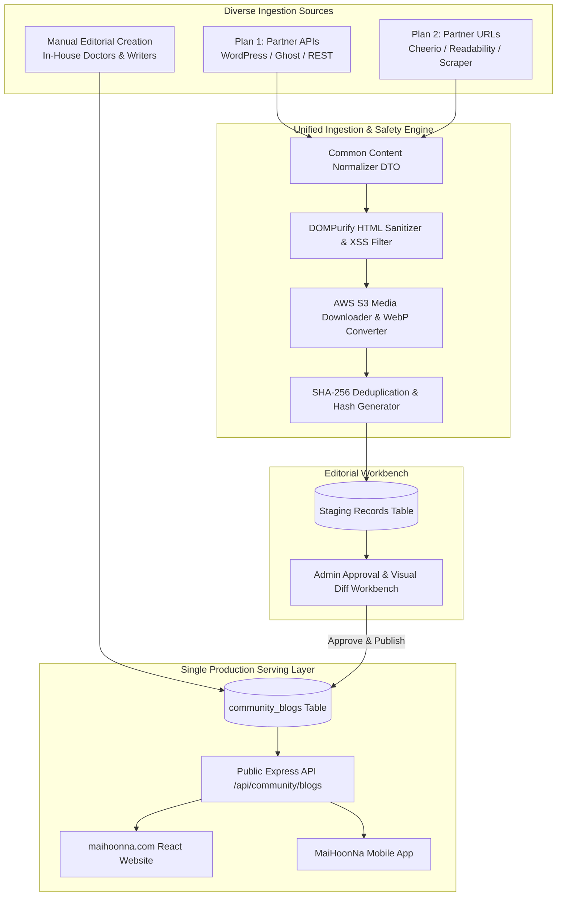
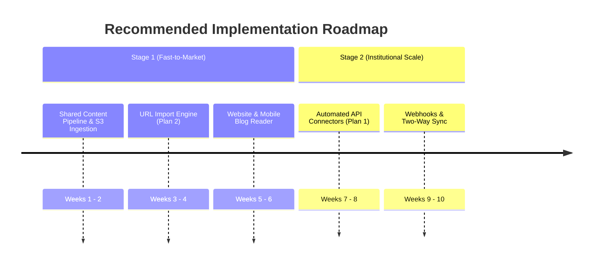

# Partner Content Integration: Technical Comparison, Hybrid Architecture & Strategic Recommendation

> **Document Type:** Architectural Evaluation & Strategic Advisory  
> **Target Audience:** Engineering Leadership, Product Management & Executive Team  
> **Related Plans:** [Plan 1: API-Based Integration](./PLAN_1_API_BASED_INTEGRATION.md) | [Plan 2: URL-Based Import](./PLAN_2_URL_BASED_CONTENT_IMPORT.md)  
> **Date:** November 2026  
> **Status:** Recommended for Executive Review  

---

## 1. Executive Summary

MaiHoonNa requires a scalable, secure, and brand-consistent mechanism to syndicate external partner articles (e.g., geriatric healthcare, elder nutrition, dementia care, legal retirement planning) and display them natively on `maihoonna.com` and the MaiHoonNa Mobile App.

This document provides a rigorous side-by-side comparison of:
- **Plan 1: API-Based Partner Content Integration** (Structured, automated, bidirectional synchronization via REST/GraphQL/Webhooks).
- **Plan 2: URL-Based Partner Content Import** (Flexible, scraping-assisted manual/semi-automated URL ingestion engine).

We also present a **Unified Hybrid Architecture** that combines the strengths of both approaches on top of MaiHoonNa’s existing `@maihoonna/database` schema, followed by a phased, pragmatic implementation recommendation.

---

## 2. Side-by-Side Architectural Comparison

| Dimension | Plan 1: API-Based Integration | Plan 2: URL-Based Content Import | Strategic Winner & Trade-Off |
|---|---|---|---|
| **1. Partner Onboarding Friction** | **High:** Requires partner to provide API access, generate keys, share documentation, or whitelist endpoints. Many senior care partners lack technical teams. | **Extremely Low:** Zero technical setup required from partner. Partner only provides URL and written syndication permission. | **Winner: Plan 2.** Fast partnership deals without waiting for partner engineering cycles. |
| **2. Development Complexity** | **Medium–High:** Must build connectors for varied APIs (WordPress, Ghost, custom REST, OAuth2, rate-limiting, error handling). | **High:** Complex parsing pipeline (Cheerio, Readability, jsdom, SSRF firewall, DOMPurify, CSS edge cases). | **Tie.** Plan 1 has connector variety; Plan 2 has DOM parsing & security complexity. |
| **3. Content Accuracy & Fidelity** | **Near 100%:** Structured JSON payload provides exact titles, markdown/HTML, high-res image URLs, author bios, and dates directly from the database. | **85%–95%:** Readability algorithms extract main text well, but custom sidebars, tables, or complex layouts may require minor manual touch-ups. | **Winner: Plan 1.** Eliminates formatting guessing or missing body paragraphs. |
| **4. Level of Automation** | **Full Automation:** Can sync 100s of articles on a cron schedule or via instant webhooks without human intervention (if auto-approve enabled). | **Semi-Automated:** Ideal for targeted, curated article selection. Admin pastes URL, reviews preview, and clicks approve. | **Winner: Plan 1** for high volume; **Winner: Plan 2** for curated quality control. |
| **5. Content Update Synchronization** | **Real-Time & Native:** Ingests remote modifications, edits, and deletions via incremental polling (`updated_after`) or webhooks. | **Polled & Reactive:** Must periodically re-scrape and hash (`SHA-256`) the target URL; cannot detect deleted articles until next crawl. | **Winner: Plan 1.** Clean lifecycle synchronization. |
| **6. Security Surface & Attack Vector** | **Controlled:** Communicates with known, authenticated partner API endpoints using static/encrypted credentials. | **High Risk if unmitigated:** Server-side fetching of arbitrary URLs opens SSRF, DNS rebinding, and malicious HTML injection. Requires strict SSRF & DOMPurify firewalls. | **Winner: Plan 1.** Narrower attack surface. |
| **7. Resilience to Website Redesigns** | **High:** Partner website frontend redesigns do not affect underlying REST/GraphQL API contracts. | **Low:** A partner frontend redesign or CMS theme change can break selector logic or trigger anti-bot protections. | **Winner: Plan 1.** API contracts remain stable across frontend redesigns. |
| **8. Ongoing Maintenance Overhead** | **Low:** Once an API connector is operational, it runs autonomously with simple health monitoring. | **Medium:** Occasional scraper adjustments when partner websites alter headers, deploy Cloudflare, or adjust DOM hierarchy. | **Winner: Plan 1.** Lower ongoing maintenance. |
| **9. Infrastructure & Running Cost** | **Minimal:** Lightweight JSON fetches, low CPU utilization, minimal worker footprint. | **Low–Moderate:** HTML parsing, image downloading, and optional headless rendering (Puppeteer) require slightly more CPU/RAM. | **Winner: Plan 1.** Lower compute footprint. |
| **10. Long-Term Scalability** | **Enterprise-Grade:** Effortlessly scales to dozens of institutional partners publishing hundreds of articles weekly. | **Editorial-Grade:** Scales well for a curated library (50–300 high-value articles), but tedious for massive high-frequency syndication. | **Winner: Plan 1** for scale. |

---

## 3. The Unified Hybrid Architecture Blueprint

Rather than treating Plan 1 and Plan 2 as mutually exclusive silos, MaiHoonNa should implement a **Unified Content Ingestion & Publishing Architecture**.

Both ingestion channels feed into a single, standardized **Staging & Approval Pipeline**, which promotes approved content into the existing `@maihoonna/database` `Blog` (`community_blogs`) table.

### 3.1 Shared Database Models
By designing shared abstractions, 80% of the database layer is shared between both plans:
1. **Target Display Table:** `Blog` (`community_blogs`) remains the **single source of truth** for all published articles. Neither the website nor the mobile app knows or cares whether an article was written in-house, fetched via an API, or imported via a URL.
2. **Attribution Model:** Both approaches use the same `Partner` model and store the original source URL, canonical URL, and partner branding.
3. **Media Pipeline:** Both approaches download remote images into MaiHoonNa’s private S3 bucket (`partners/media/`), eliminating broken hotlinks and expired external CDNs.

---

## 4. Strategic Technical Recommendation

### The Core Problem in Practice
- If MaiHoonNa chooses **Plan 1 (API only)**: Partnership discussions will stall because 70% of potential senior care partners (independent clinics, geriatric specialists, senior magazines) do not have developer teams to configure API tokens, endpoints, or webhooks.
- If MaiHoonNa chooses **Plan 2 (URL import only)**: Large institutional partners (e.g., Fortis, Apollo, Max Healthcare, national health portals) who publish multiple articles weekly will find manual URL pasting inefficient and unscalable.

### Recommended Strategy: Two-Stage Hybrid Rollout

#### Stage 1: Build the Core Pipeline + URL-Based Import (Weeks 1 to 6)
1. **Build the Shared Foundation:**
   - Establish the `Partner` schema, S3 asset ingestion engine, and HTML sanitizer in `apps/admin-backend`.
   - Build the public `/blog` and `/blog/:slug` frontend in `apps/website` and wire the existing mobile app reader.
2. **Implement URL-Based Import (Plan 2):**
   - Implement Cheerio + Readability extraction and the admin editorial workbench.
   - **Business Impact:** MaiHoonNa can immediately onboard any partner on Day 1. Marketing and editorial teams can curate the top 50 high-value senior care articles from partners within days of signing syndication agreements, requiring zero technical effort from partners.

#### Stage 2: Add API Automation for Major Partners (Weeks 7 to 10)
1. **Implement API Connectors (Plan 1):**
   - Add the WordPress and Generic REST connectors to the existing ingestion pipeline.
   - Set up scheduled Redis cron polling and inbound webhook receivers.
2. **Business Impact:** High-volume institutional partners can be migrated to full automation, where new health articles appear in the admin approval worklist automatically upon remote publication.

---

## 5. Architectural Decisions Requiring Team Alignment

Before development begins, the engineering and leadership teams should align on the following policy and architectural decisions:

### Decision 1: Canonical URL Policy (SEO Strategy)
* **Option A (Strict External Canonical):** Point `<link rel="canonical" href="https://partnerwebsite.com/article" />`.
  - *Pros:* 100% compliant with partner expectations; zero risk of Google duplicate content penalties.
  - *Cons:* MaiHoonNa will not rank on Google for this article; all search engine authority flows to the partner.
* **Option B (Self-Canonicalization with Attribution):** Point `<link rel="canonical" href="https://maihoonna.com/blog/article" />` while providing clear visible attribution and a backlink.
  - *Pros:* MaiHoonNa gains organic search traffic and keyword footprint in senior care.
  - *Cons:* Requires explicit contractual agreement from the partner. If both sites have identical content and self-canonicalize, Google may choose which one to index.
* **Recommendation:** Support both via `Partner.canonicalStrategy` enum (`ORIGINAL_SOURCE` vs `SELF_CANONICAL`). Default to `ORIGINAL_SOURCE` unless co-syndication terms explicitly allow self-canonicalization.

### Decision 2: Editorial Review vs. Auto-Publishing
* **Option A (Mandatory Editorial Approval):** All synced or imported articles land in `PENDING_REVIEW` and require an editor to click "Approve".
* **Option B (Auto-Publish for Whitelisted Partners):** Trusted medical partners automatically go live to the website.
* **Recommendation:** **Mandatory Editorial Approval by default.** Senior healthcare requires clinical and brand safety. External articles must be vetted to ensure they do not recommend contraindicated medications, unverified remedies, or competitors.

### Decision 3: Image Ingestion & S3 Storage Policy
* **Option A (Direct Mirroring to S3 - Recommended):** Download all featured and inline images, convert to `.webp`, and store in MaiHoonNa’s private S3 bucket.
  - *Pros:* Guarantees images never break, prevents mixed-content HTTPS errors, and loads fast via CloudFront.
  - *Cons:* Incurs minor AWS S3 storage and data transfer costs (~$5–$15/month for 5,000 articles).
* **Option B (Remote Hotlinking):** Store partner image URLs directly.
  - *Pros:* Zero storage cost.
  - *Cons:* High risk of broken images if partner deletes assets, CORS failures, slow third-party CDNs.
* **Recommendation:** **Option A (Direct S3 Mirroring).** A broken image on an elder care portal degrades trust and visual polish.

---

## 6. Summary of Output Documents

The complete specifications have been documented in the repository under `docs/partner-content-integration/`:

1. 📄 **[Plan 1: API-Based Partner Content Integration](file:///Users/puneet/Desktop/MHN/docs/partner-content-integration/PLAN_1_API_BASED_INTEGRATION.md)**  
   *Covers partner API management, OAuth2/API Key security, connector architecture, incremental sync, webhook receivers, and automated synchronization.*
2. 📄 **[Plan 2: URL-Based Partner Content Import](file:///Users/puneet/Desktop/MHN/docs/partner-content-integration/PLAN_2_URL_BASED_CONTENT_IMPORT.md)**  
   *Covers URL scraping, Cheerio/Readability extraction, SSRF defense, DOMPurify sanitization, S3 asset mirroring, and the admin editorial workbench.*
3. 📄 **[Comparison, Shared Architecture & Recommendation](file:///Users/puneet/Desktop/MHN/docs/partner-content-integration/COMPARISON_AND_RECOMMENDATION.md)** *(This Document)*  
   *Covers side-by-side trade-offs, the unified hybrid architecture, rollout phases, and key business decisions.*

