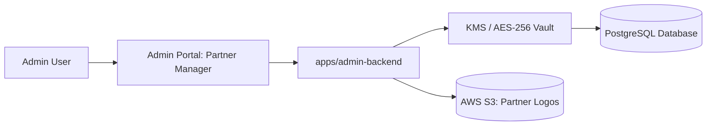
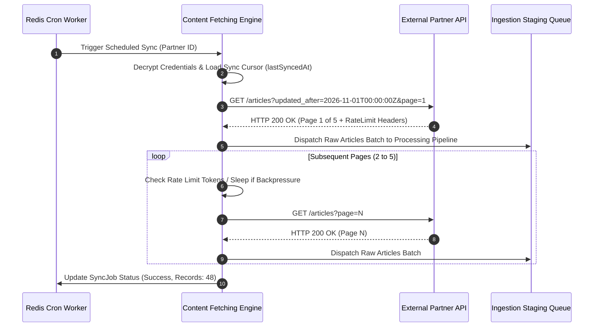
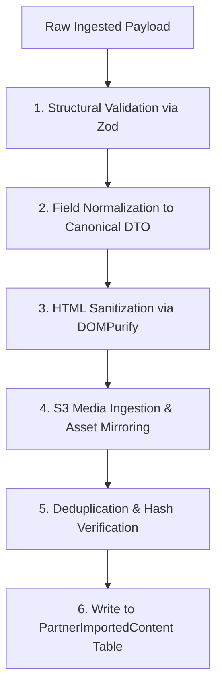
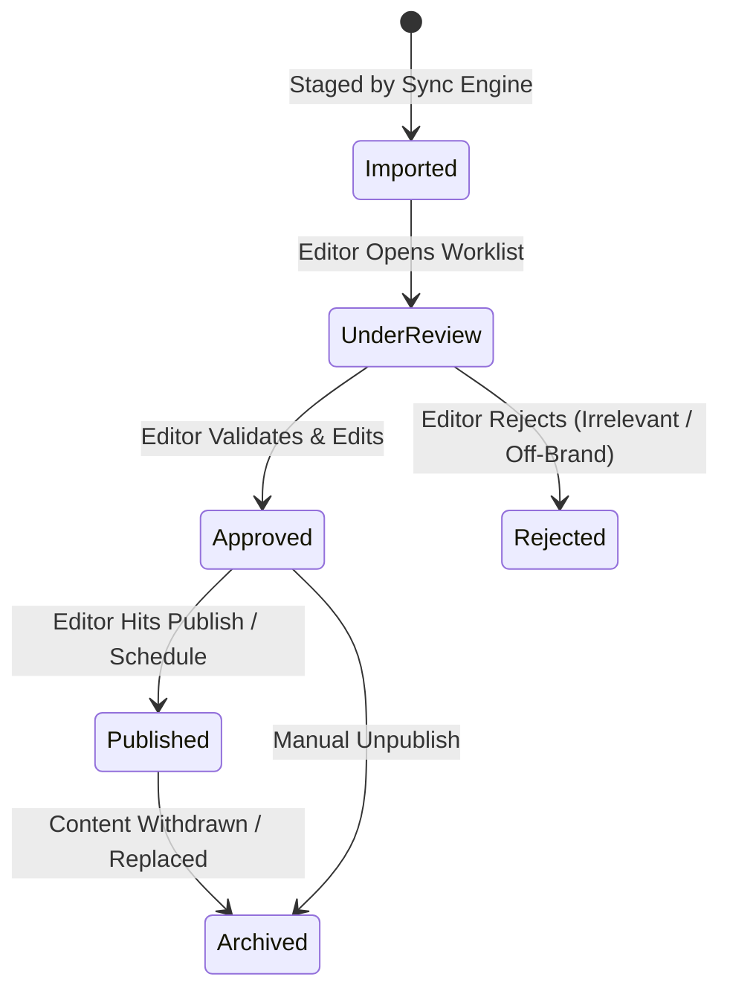
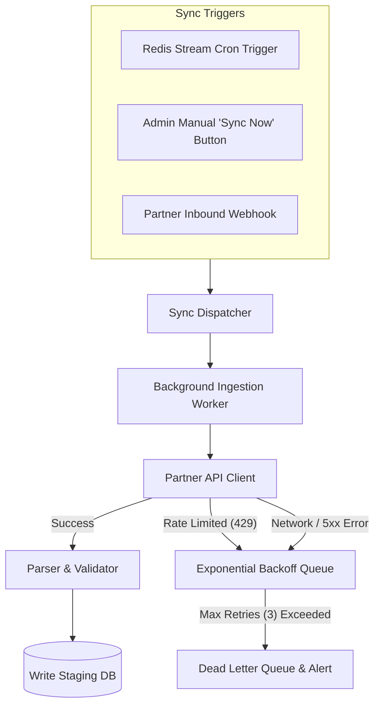

# Technical Implementation Plan 1: API-Based Partner Content Integration

> **Document Type:** Technical Architecture & Implementation Specification  
> **Target Platform:** MaiHoonNa (MHN) Senior Care Ecosystem  
> **Scope:** Admin Portal, Main API (`apps/api`), Admin Backend (`apps/admin-backend`), Database (`@maihoonna/database`), Public Website (`apps/website`), and Mobile App (`apps/mobile-app`)  
> **Status:** Draft for Technical Review & Architecture Approval  

---

## Executive Summary

This document specifies the end-to-end architecture and implementation plan for integrating external partner website content into the MaiHoonNa platform via **automated API synchronization**.

The objective is to establish bilateral or syndicated digital partnerships (e.g., geriatric medical journals, wellness publications, elder legal advisors, health tech blogs) and display their authorized content seamlessly across `maihoonna.com` and the MaiHoonNa Mobile App. Content is ingested through partner-provided REST/GraphQL APIs, normalized into MaiHoonNa’s standardized schema, staged in an administrative approval pipeline, and rendered natively using MaiHoonNa’s warm healthcare visual identity (`#FE6700` Orange, `#FAF3EB` Beige, Poppins typography) with full SEO optimization and partner attribution.

---

## Section A: Existing Project Architecture Analysis

Before designing the integration, a comprehensive audit of the MaiHoonNa repository was conducted to ensure alignment with existing patterns:

| Architectural Layer | Current Repository Implementation | Integration Alignment & Reusability |
|---|---|---|
| **Primary Backend (`apps/api`)** | Express 5 with TypeScript, modular routing (`/api/subscriber`, `/api/beneficiary`, `/api/community`), JWT authentication (`authenticate`, `optionalAuthenticate`), Helmet, Morgan, and Redis integration. | Will host the public-facing content delivery endpoints (`/api/community/blogs`) and external webhook receivers (`/api/webhooks/partner/:partnerId`). |
| **Admin Backend (`apps/admin-backend`)** | Node.js Express service, RBAC middleware (`verifyToken`, `authorizeRoles`), Prisma client, Multer for file uploads, and centralized AWS S3 storage handling. | Will host the Partner Management, API Configuration, Manual Sync Triggers, and Content Approval routes (`/api/admin/partners`, `/api/admin/partner-content`). |
| **Database (`packages/database`)** | PostgreSQL hosted on Supabase, managed via Prisma ORM (`schema.prisma`). Already contains the newly introduced Community models: `Blog`, `CommunityEvent`, `Podcast`, `ContentCategory`, `ContentAuthor`, `ContentBookmark`, `ContentLike`, `ContentView`. | We will introduce additive models: `Partner`, `PartnerApiConfig`, `PartnerSyncJob`, `PartnerImportedContent`, and `PartnerSyncErrorLog`. We will link `PartnerImportedContent` to the existing `Blog` (`community_blogs`) table. |
| **Media & File Storage** | AWS S3 via `@aws-sdk/client-s3`. Core design pattern: **Raw storage keys** are stored in the database (e.g., `community/blogs/thumb-xyz.jpg`), and presigned/CDN URLs are dynamically generated at query time using `resolveFileUrl` (`urlResolver.js`). | External partner images and thumbnails will be downloaded and ingested directly into our private S3 bucket under `partners/media/` to avoid broken hotlinks, third-party CORS blocks, and expired remote URLs. |
| **Asynchronous Jobs & Messaging** | `@maihoonna/notifications` contains a production-ready **Redis Streams** infrastructure (`redis.connection.ts`, `notification.producer.ts`, `notification.consumer.ts`). | Partner API scheduled synchronization and incremental polling jobs will utilize this existing Redis connection, avoiding additional broker dependencies. |
| **Admin Frontend (`apps/admin-frontend`)** | React 18, Vite, React Router v7 (Data mode), Tailwind CSS v4, Radix UI primitives, Lucide React icons, Sonner for toast notifications. Existing Community pages at `src/app/pages/community/*`. | New admin views (Partner Directory, API Config Wizard, Import Approval Worklist) will be created as sub-modules within the existing `DashboardLayout.tsx` and styled using existing design tokens. |
| **Public Website (`apps/website`)** | React (Vite-based SPA) with client-side history state routing (`window.history.pushState` with `popstate`/`hashchange`), custom `Header`, `Footer`, `SeoHead` (dynamic meta tags, canonical link, Open Graph), and brand styling. | Needs a new `/blog` catalog and `/blog/:slug` dynamic article view styled natively with the existing `site-shell` header/footer layout. |
| **Mobile Application (`apps/mobile-app`)** | React Native with Expo, Expo Router (file-based routing), TanStack React Query, responsive layout helpers. Already contains `app/(community)/blogs/[id].tsx` with elderly accessibility features (dynamic font scaling: 1.0x, 1.2x, 1.4x), bookmarks, and likes. | Reuses the existing reader screen seamlessly. Approved partner articles will automatically surface in the community feed. |

---

## 1. Partner Management System

The Partner Management module enables MaiHoonNa administrators to register, configure, monitor, and govern all external content partners from the admin dashboard.



### 1.1 Capabilities
1. **Partner Entity Directory:**
   - Create, read, update, and soft-delete partner profiles.
   - Capture commercial and operational metadata: Organization Name, Legal Contact, Technical Contact Email, Website Domain, Partner Tier (Syndication, Affiliate, Medical Authority), and Revocation Status.
2. **API Configuration Wizard:**
   - **Protocol Support:** REST JSON, GraphQL, and RSS/Atom with JSON feed bridge.
   - **Authentication Handshake Configurations:**
     - `API_KEY`: Custom Header (e.g., `X-API-Key`, `api-key`) or Query Parameter.
     - `BEARER_TOKEN`: Static long-lived Bearer tokens.
     - `OAUTH2_CLIENT_CREDENTIALS`: Token Endpoint URL, Client ID, Client Secret, Scope, and automatic token refresh caching.
     - `BASIC_AUTH`: Base64-encoded username/password.
     - `CUSTOM_HEADERS`: Arbitrary key-value headers (e.g., `User-Agent`, `X-Partner-Client-Id`).
3. **Endpoint & Contract Mapping:**
   - Base API URL (e.g., `https://api.geriatrichealth.org/v2`).
   - Articles Listing Endpoint (e.g., `/articles`, `/posts`, `/content`).
   - Single Article Detail Endpoint (e.g., `/articles/:id`).
   - Categories/Tags Taxonomy Endpoint.
   - Webhook Secret & Verification Signature Header.
4. **Synchronization Governance:**
   - Ingestion Frequency: Hourly (`0 * * * *`), Every 6 Hours (`0 */6 * * *`), Daily at Midnight (`0 0 * * *`), or Manual Only.
   - Rate Limit Guard: Max requests per minute, burst allowance, concurrency limits.
   - Auto-Approve Toggle: Require manual editorial approval (default: `true`) vs. Auto-Publish for trusted partners (`false`).

---

## 2. Content Fetching Engine

The Content Fetching Engine connects to external partner endpoints, manages pagination, navigates rate limits, and ingests raw payloads into MaiHoonNa's ingestion queue.



### 2.1 Fetching Strategy & Data Retrieval
The fetcher uses an extensible **Connector Adapter Pattern** (`IPartnerConnector`):
- `WordPressConnector`: Interacts with standard `wp-json/wp/v2/posts?_embed=1`.
- `GhostConnector`: Interacts with Ghost Content API `ghost/api/content/posts/?key=...&include=tags,authors`.
- `StrapiConnector`: Interacts with Strapi REST endpoints `/api/articles?populate=*`.
- `GenericRestConnector`: Configurable field-mapping adapter for custom REST schemas.

### 2.2 Content Artifacts Ingested
* **Article Metadata:** Title, Slug, Canonical Source URL, Language (`en`, `hi`, etc.).
* **Content Bodies:** Short excerpt/summary (`shortDescription`), full body HTML or Markdown (`richContent`), and structured headings.
* **Media Assets:** Featured image/thumbnail URL, inline illustration/figure URLs, embedded video links (YouTube, Vimeo).
* **Taxonomy:** Primary Category, Secondary Categories, Keywords/Tags.
* **Author Details:** Author Name, Avatar Image URL, Professional Title, Short Bio.
* **Timestamps:** Original Publication Date (`publishedAt`), Last Modified Date on Partner System (`updatedAt`).

### 2.3 Incremental Sync & Pagination
- **Incremental Sync Cursor:** Queries append `updated_after={lastSyncedAt}` or `since_id={lastKnownId}`.
- **Pagination Handlers:**
  - `PAGE_NUMBER`: `?page=1&limit=50`
  - `OFFSET_LIMIT`: `?offset=100&limit=50`
  - `CURSOR_BASED`: `?cursor=eyJpZCI6MTIzfQ==`
  - `LINK_HEADER`: RFC 5988 `rel="next"` header navigation.
- **Rate Limit & Throttling Guard:**
  - Inspects `X-RateLimit-Remaining` and `Retry-After` headers.
  - Implements a Leaky Bucket rate limiter per partner in Redis to prevent API bans.
  - Automatic exponential backoff with jitter on HTTP `429 Too Many Requests` or `5xx Server Errors`.

---

## 3. Content Processing & Normalization Pipeline

Raw data from external sources cannot be stored directly in production tables. It passes through a multi-stage validation and transformation pipeline.



### 3.1 Pipeline Stages
1. **Validation:** Schema validation via `Zod`. Rejects malformed payloads missing mandatory fields (`title`, `content`, `originalId`).
2. **Normalization:** Maps heterogeneous keys into a standardized internal representation:
   - `wp:featuredmedia[0].source_url` OR `cover_image` OR `hero_image` $\rightarrow$ `sourceThumbnailUrl`.
   - `content.rendered` OR `body` OR `markdown` $\rightarrow$ `normalizedHtmlContent`.
   - `tags[].name` OR `keywords` $\rightarrow$ `tags: string[]`.
3. **HTML Sanitization & Safety:**
   - Strips malicious elements: `<script>`, `<iframe>` (except whitelisted YouTube/Vimeo embeds), `<object>`, `<embed>`, inline event listeners (`onload`, `onerror`), and tracking pixels.
   - Cleans external inline styling (`style="..."`) to ensure all articles adopt MaiHoonNa’s native design typography and spacing.
4. **Media Asset Ingestion (S3 Mirroring):**
   - External images are downloaded over HTTPS by the backend worker.
   - Validated for valid image MIME types (`image/jpeg`, `image/png`, `image/webp`).
   - Uploaded to MaiHoonNa's AWS S3 bucket: `partners/{partnerId}/images/{year}/{month}/{hash}.webp`.
   - Replaces external hotlinks in the article content with permanent S3 raw storage keys, resolved via `resolveFileUrl` (CloudFront CDN).
5. **Deduplication & Revision Tracking:**
   - Calculates a cryptographic SHA-256 hash of the content body: `contentHash = sha256(normalizedHtmlContent)`.
   - Checks against existing `PartnerImportedContent` records matching `(partnerId, originalContentId)`.
   - If identical hash exists: Ignores update (prevents redundant review cycles).
   - If hash differs: Creates a new `PartnerContentRevision` entry, logs diff, and flags record as `UPDATED_PENDING_REVIEW`.
6. **Deletion & Withdrawal Handling:**
   - If partner returns HTTP `404` or an explicit deleted status in the feed, the item is flagged as `WITHDRAWN_BY_PARTNER`.
   - If already published to live `Blog`, it is immediately unpublished (`status: archived`) to uphold partner syndication compliance.

---

## 4. Admin Approval & Editorial Workflow

Before any external content becomes visible to seniors or family caregivers, it must pass through editorial governance.



### 4.1 Editorial Actions & Capabilities
* **Side-by-Side Review Screen:**
  - Left pane: Extracted raw partner article + original source link.
  - Right pane: Editable MaiHoonNa article draft (Title, Excerpt, Rich Content, Category, Tags).
* **Asset Override:** Option to retain the partner's mirrored image or upload a custom MaiHoonNa branded thumbnail.
* **Category & Author Mapping:**
  - Auto-maps partner categories to MaiHoonNa `ContentCategory` (e.g., Partner's *"Dementia Care"* $\rightarrow$ MaiHoonNa's *"Mental Health & Memory"*).
  - Associates with a registered `ContentAuthor` or assigns a specialized **Partner Author Badge** (e.g., *"Dr. K. Sharma (Courtesy of HealthCarePartner.in)"*).
* **Attribution Configuration:**
  - Toggles mandatory partner attribution banner:
    > *"This article was originally published by **HealthCarePartner** and syndicated with permission. [Read Original Article] ↗"*
* **Publishing Actions:**
  - **Approve & Publish Immediately:** Promotes the record to the live `community_blogs` table (`status: published`, `publishedAt: now()`).
  - **Approve & Schedule:** Sets `scheduledPublishAt` for staggered release.
  - **Reject:** Marks as `rejected` with an editorial reason (e.g., duplicate, off-topic, advertorial).

---

## 5. Website & Mobile App Native Presentation

When users open a syndicated article, it is completely indistinguishable from first-party MaiHoonNa content, adhering strictly to our design system tokens while legally and transparently attributing the source.

```
┌────────────────────────────────────────────────────────┐
│ MAIHOONNA  Home  Services  Saathi  Legacy  Blog  Login │
├────────────────────────────────────────────────────────┤
│ 🏷️ Care & Wellness • 5 min read • Published Nov 2, 2026 │
│                                                        │
│ Effective Ways to Manage Arthritic Knee Pain in Winter │
│                                                        │
│ ┌────────────────────────────────────────────────────┐ │
│ │ 🤝 In Partnership with Fortis Geriatric Care       │ │
│ │ Authored by Dr. Sunita Rao, MD (Rheumatology)      │ │
│ └────────────────────────────────────────────────────┘ │
│                                                        │
│ [ High-Resolution Mirrored Image from S3 / CloudFront] │
│                                                        │
│ As temperatures drop across North India, senior...     │
│ [Fully Native Typography: Poppins / Charcoal #1F2937]  │
│                                                        │
│ ────────────────────────────────────────────────────── │
│ ℹ️ Partner Source Attribution                          │
│ Originally published by Fortis Healthcare.             │
│ Canonical: fortishealthcare.com/blog/knee-pain-winter  │
│ [ Share Article ]  [ Bookmark ]  [ Consult a Saathi ]  │
└────────────────────────────────────────────────────────┘
```

### 5.1 Routing & URL Structure
* **Listing Page:** `maihoonna.com/blog` (with category filters: All, Health, Nutrition, Memory, Legal).
* **Article Page:** `maihoonna.com/blog/:slug` (e.g., `maihoonna.com/blog/effective-ways-to-manage-arthritic-knee-pain-winter`).
* **Mobile App Screen:** Dynamic deep-link `mhn://community/blogs/:id` opening `apps/mobile-app/app/(community)/blogs/[id].tsx`.

### 5.2 SEO & Search Engine Optimization
To ensure search engines index the content properly while adhering to Google's duplicate content and syndication guidelines:
1. **Canonical URL Specification:**
   - If the partnership agreement requires canonical attribution to the partner:
     `<link rel="canonical" href="https://partnerwebsite.com/blog/elder-care" />`
   - If the partnership agreement grants exclusive or co-owned syndication rights with self-canonicalization:
     `<link rel="canonical" href="https://maihoonna.com/blog/elder-care" />`
   - Configurable per partner via `Partner.canonicalStrategy` (`ORIGINAL_SOURCE` vs. `SELF_CANONICAL`).
2. **Structured Data (Schema.org / JSON-LD):**
   ```json
   {
     "@context": "https://schema.org",
     "@type": "BlogPosting",
     "headline": "Effective Ways to Manage Arthritic Knee Pain in Winter",
     "image": ["https://cdn.maihoonna.com/partners/fortis/images/knee-care.webp"],
     "datePublished": "2026-11-02T10:00:00+05:30",
     "dateModified": "2026-11-03T14:30:00+05:30",
     "author": {
       "@type": "Person",
       "name": "Dr. Sunita Rao"
     },
     "publisher": {
       "@type": "Organization",
       "name": "MaiHoonNa Senior Care",
       "logo": {
         "@type": "ImageObject",
         "url": "https://maihoonna.com/logo.png"
       }
     },
     "isBasedOn": "https://partnerwebsite.com/blog/elder-care",
     "description": "Comprehensive winter arthritis management guide for elderly patients."
   }
   ```
3. **Open Graph & Twitter Cards:**
   Generated dynamically via `SeoHead.jsx` on web and shared natively via React Native `Share` module on mobile.

---

## 6. Synchronization Engine & Resilience



### 6.1 Synchronization Modes
1. **Scheduled Sync (Polling):** Managed by Redis-backed cron runner (`notification.consumer.ts` queue worker). Polls active partners according to their configured cron expressions.
2. **Inbound Webhook Sync (Push):**
   - Partner dispatches `POST /api/webhooks/partner/:partnerId` on publish/update.
   - Endpoint verifies HMAC-SHA256 signature using `PartnerApiConfig.webhookSecret`.
   - Enqueues background sync job for the specific updated entity ID, responding `HTTP 202 Accepted` within 200ms.
3. **Manual On-Demand Sync:** Administrator taps `"Sync Now"` on a partner card to trigger an immediate delta sync for testing or breaking news.

### 6.2 Failure Handling & Retries
- **Retry Mechanism:** Failed HTTP requests retry up to 3 times with exponential backoff ($2^n \times 1000\text{ ms} + \text{jitter}$).
- **Dead-Letter Queue (DLQ):** Unrecoverable failures are logged to `PartnerSyncErrorLog` with full request/response headers, stack trace, and timestamp.
- **Admin Alerting:** If a partner fails 3 consecutive sync cycles, `Partner.syncStatus` transitions to `FAILED`, and an alert notification is dispatched to system admins.

---

## 7. Security Architecture

1. **Credential Encryption at Rest:**
   - Partner API keys, OAuth client secrets, and bearer tokens are stored in the database encrypted using **AES-256-GCM**.
   - Encryption keys are stored in `PARTNER_CREDENTIAL_ENCRYPTION_KEY` environment variable (or AWS Secrets Manager in production).
   - Plaintext credentials are never logged, never returned to frontend admin APIs, and only decrypted in-memory during sync execution.
2. **Access Control (RBAC):**
   - Partner configuration routes: Restricted to `master_admin` and `admin`.
   - Content review and approval: Accessible to `admin`, `operations_manager`, and editorial staff.
   - Public content APIs: Open/read-only with rate limiting.
3. **SSRF Defense on Outbound Calls:**
   - Partner API Base URLs must strictly use `https://`.
   - Hostnames are resolved through DNS and validated to ensure they do not resolve to private IP spaces (RFC 1918: `10.0.0.0/8`, `172.16.0.0/12`, `192.168.0.0/16`), loopback (`127.0.0.1`), or AWS instance metadata service (`169.254.169.254`).
4. **Input Sanitization & Output Encoding:**
   - HTML sanitization prevents stored XSS via compromised partner endpoints.

---

## 8. Proposed API Architecture

### 8.1 MaiHoonNa Application APIs (Internal & Admin)

#### Admin Partner Management (`apps/admin-backend` $\rightarrow$ `/api/admin/partners`)
* `GET /api/admin/partners`: List all partners with sync status, article counts, and health flags.
* `POST /api/admin/partners`: Register a new partner.
* `GET /api/admin/partners/:id`: Retrieve partner profile and integration details (secrets masked).
* `PUT /api/admin/partners/:id`: Update partner metadata and sync schedule.
* `PATCH /api/admin/partners/:id/status`: Toggle partner active/inactive state.
* `POST /api/admin/partners/:id/test-connection`: Perform live handshake against partner endpoint.
* `POST /api/admin/partners/:id/sync-now`: Trigger immediate background sync job.

#### Admin Content Review (`apps/admin-backend` $\rightarrow$ `/api/admin/partner-content`)
* `GET /api/admin/partner-content`: Filterable list of imported articles (`pending_review`, `approved`, `rejected`, `updated`).
* `GET /api/admin/partner-content/:id`: Detailed view with diff and preview.
* `PUT /api/admin/partner-content/:id`: Edit title, description, rich text, categories before approval.
* `POST /api/admin/partner-content/:id/approve`: Approve and promote to live `Blog` table.
* `POST /api/admin/partner-content/:id/reject`: Reject imported article.
* `POST /api/admin/partner-content/:id/unpublish`: Take down previously published article.

#### Public Inbound Webhooks (`apps/api` $\rightarrow$ `/api/webhooks`)
* `POST /api/webhooks/partner/:partnerId`: Receive real-time push events (`post.published`, `post.updated`, `post.deleted`).

#### Public Content Delivery (`apps/api` $\rightarrow$ `/api/community`)
* `GET /api/community/blogs`: Enhanced to support syndicated partner filtering, tag filtering, and pagination.
* `GET /api/community/blogs/:slug`: Return full blog post with partner attribution object.

### 8.2 Partner-Provided External APIs (Required from Partner)
To integrate via Plan 1, the partner must supply either:
1. **Option A (Standard REST):**
   - `GET /articles?updated_after=...&page=...&limit=...`
   - `GET /articles/:id`
2. **Option B (WordPress REST API):**
   - `GET /wp-json/wp/v2/posts?_embed=1&after=...&page=...`
3. **Option C (Webhook Dispatcher):**
   - Ability to send JSON HTTP POST requests on publish events to our webhook URL.

---

## Section B: Database Design (Prisma Schema Extensions)

Add the following models into `packages/database/prisma/schema.prisma`:

```prisma
// ─── PARTNER CONTENT INTEGRATION DOMAIN ────────────────────────────────────

enum PartnerAuthType {
  API_KEY
  BEARER_TOKEN
  OAUTH2_CLIENT_CREDENTIALS
  BASIC_AUTH
  NONE
}

enum PartnerSyncStatus {
  IDLE
  SYNCING
  SUCCESS
  FAILED
  DISABLED
}

enum PartnerContentApprovalStatus {
  PENDING_REVIEW
  APPROVED
  REJECTED
  UPDATED_PENDING_REVIEW
  WITHDRAWN_BY_PARTNER
}

enum CanonicalStrategy {
  ORIGINAL_SOURCE
  SELF_CANONICAL
  CUSTOM
}

model Partner {
  id                  String             @id @default(uuid())
  name                String             // e.g. "Fortis Geriatric Health"
  slug                String             @unique
  websiteUrl          String             // e.g. "https://fortishealthcare.com"
  logoStorageKey      String?            // S3 storage key
  contactName         String?
  contactEmail        String?
  partnerType         String             @default("syndication") // syndication | medical_partner | affiliate
  canonicalStrategy   CanonicalStrategy  @default(ORIGINAL_SOURCE)
  defaultAttribution  String?            @db.Text
  isActive            Boolean            @default(true)
  autoApproveContent  Boolean            @default(false)
  syncStatus          PartnerSyncStatus  @default(IDLE)
  lastSyncedAt        DateTime?
  lastSyncResult      String?            @db.Text // JSON summary of last sync run
  createdAt           DateTime           @default(now())
  updatedAt           DateTime           @updatedAt

  apiConfig           PartnerApiConfig?
  importedArticles    PartnerImportedContent[]
  syncJobs            PartnerSyncJob[]
  errorLogs           PartnerSyncErrorLog[]

  @@map("content_partners")
}

model PartnerApiConfig {
  id                  String          @id @default(uuid())
  partnerId           String          @unique
  connectorType       String          @default("GENERIC_REST") // WORDPRESS | GHOST | STRAPI | GENERIC_REST
  baseApiUrl          String          // e.g. "https://api.fortishealthcare.com/v1"
  articlesEndpoint    String          @default("/articles")
  articleDetailEndpoint String?       // e.g. "/articles/:id"
  authType            PartnerAuthType @default(API_KEY)
  
  // Encrypted Credentials (AES-256-GCM)
  encryptedAuthPayload String         @db.Text // Holds API Key, Token, or Client Secret
  authKeyHeaderName   String?         @default("X-API-Key")
  oauthTokenUrl       String?
  oauthClientId       String?
  oauthScope          String?

  // Field Mapping Overrides (JSON string for custom REST connectors)
  fieldMappingJson    String?         @db.Text
  
  // Rate Limits & Schedule
  cronExpression      String          @default("0 */6 * * *") // Every 6 hours
  requestsPerMinute   Int             @default(60)
  pageSize            Int             @default(50)
  
  // Webhooks
  webhookSecret       String?
  
  createdAt           DateTime        @default(now())
  updatedAt           DateTime        @updatedAt

  partner             Partner         @relation(fields: [partnerId], references: [id], onDelete: Cascade)

  @@map("partner_api_configs")
}

model PartnerImportedContent {
  id                   String                       @id @default(uuid())
  partnerId            String
  originalContentId    String                       // Partner's internal primary key / ID
  originalUrl          String                       @db.Text
  canonicalUrl         String?                      @db.Text
  
  // Raw & Normalized Content
  title                String
  slug                 String
  shortDescription     String                       @db.VarChar(500)
  normalizedContent    String                       @db.Text
  rawSourcePayload     String                       @db.Text // Preserved raw JSON for debugging
  contentHash          String                       // SHA-256 hash to detect changes
  
  // Taxonomy & Metadata
  language             ContentLanguage              @default(en)
  rawCategoryName      String?
  mappedCategoryId     String?
  rawAuthorName        String?
  rawAuthorBio         String?
  mappedAuthorId       String?
  tags                 String[]                     @default([])
  
  // Media Assets
  sourceThumbnailUrl   String?                      @db.Text
  mirroredThumbnailKey String?                      // Our S3 key
  sourceMediaUrls      String[]                     @default([])
  
  // Approval & Publication State
  approvalStatus       PartnerContentApprovalStatus @default(PENDING_REVIEW)
  publishedBlogId      String?                      @unique // Linked to community_blogs if approved
  reviewedById         String?
  reviewedAt           DateTime?
  rejectionReason      String?                      @db.Text
  originalPublishedAt  DateTime?
  
  createdAt            DateTime                     @default(now())
  updatedAt            DateTime                     @updatedAt

  partner              Partner                      @relation(fields: [partnerId], references: [id], onDelete: Cascade)
  mappedCategory       ContentCategory?             @relation(fields: [mappedCategoryId], references: [id])
  mappedAuthor         ContentAuthor?               @relation(fields: [mappedAuthorId], references: [id])
  reviewedBy           User?                        @relation("PartnerReviewer", fields: [reviewedById], references: [id])
  publishedBlog        Blog?                        @relation("PartnerPublishedBlog", fields: [publishedBlogId], references: [id])
  revisions            PartnerContentRevision[]

  @@unique([partnerId, originalContentId])
  @@index([partnerId, approvalStatus])
  @@index([contentHash])
  @@map("partner_imported_content")
}

model PartnerContentRevision {
  id                   String                 @id @default(uuid())
  importedContentId    String
  revisionNumber       Int
  title                String
  content              String                 @db.Text
  contentHash          String
  diffSummary          String?                @db.Text
  createdAt            DateTime               @default(now())

  importedContent      PartnerImportedContent @relation(fields: [importedContentId], references: [id], onDelete: Cascade)

  @@index([importedContentId])
  @@map("partner_content_revisions")
}

model PartnerSyncJob {
  id                   String                 @id @default(uuid())
  partnerId            String
  triggerType          String                 // CRON | MANUAL | WEBHOOK
  status               String                 // PENDING | RUNNING | COMPLETED | FAILED
  itemsFetched         Int                    @default(0)
  itemsCreated         Int                    @default(0)
  itemsUpdated         Int                    @default(0)
  itemsFailed          Int                    @default(0)
  startedAt            DateTime               @default(now())
  completedAt          DateTime?
  errorMessage         String?                @db.Text

  partner              Partner                @relation(fields: [partnerId], references: [id], onDelete: Cascade)

  @@index([partnerId, startedAt])
  @@map("partner_sync_jobs")
}

model PartnerSyncErrorLog {
  id                   String                 @id @default(uuid())
  partnerId            String
  syncJobId            String?
  endpoint             String
  httpStatus           Int?
  errorMessage         String                 @db.Text
  errorStack           String?                @db.Text
  createdAt            DateTime               @default(now())

  partner              Partner                @relation(fields: [partnerId], references: [id], onDelete: Cascade)

  @@index([partnerId, createdAt])
  @@map("partner_sync_error_logs")
}
```

*Note: In `model Blog`, add relational field `partnerSource PartnerImportedContent? @relation("PartnerPublishedBlog")` to tie syndicated blogs back to their source.*

---

## Section C: Admin Panel UI/UX Specifications

The integration introduces a dedicated **Partner Content Management** navigation group in `apps/admin-frontend`.

```
┌────────────────────────────────────────────────────────────────────────┐
│  MaiHoonNa Admin Portal               [🔔 Staff Alert] [Dr. Verma ▾]   │
├─────────────────┬──────────────────────────────────────────────────────┤
│ 📊 Dashboard    │ 🤝 Partner Content Management                        │
│ 👥 Users        │ ┌──────────────────────────────────────────────────┐ │
│ 📅 Visits       │ │ [ + Add New Partner ]  [ 🔄 Sync All Active ]    │ │
│ 🩺 Vitals       │ └──────────────────────────────────────────────────┘ │
│                 │                                                      │
│ 🤝 PARTNERS     │ ACTIVE PARTNERS (3)                                  │
│ • Directory     │ ┌──────────────────────────────────────────────────┐ │
│ • Import Queue  │ │ 🏥 Fortis Geriatric Health Care                  │ │
│ • Published     │ │ Status: 🟢 Active • Last Sync: Today, 08:30 AM    │ │
│                 │ │ Articles: 42 Ingested (4 Pending Review)         │ │
│ 📚 COMMUNITY    │ │ [ ⚙️ Configure API ]  [ 🔄 Sync Now ] [ Review ]  │ │
│ • Events        │ └──────────────────────────────────────────────────┘ │
│ • Blogs         │ ┌──────────────────────────────────────────────────┐ │
│ • Podcasts      │ │ 📰 Senior Living India Magazine                  │ │
│                 │ │ Status: 🟡 Warning (Rate Limited) • Sync: 2d ago │ │
│ ⚙️ Settings     │ │ [ ⚙️ Configure API ]  [ 🔄 Sync Now ] [ Review ]  │ │
│                 │ └──────────────────────────────────────────────────┘ │
└─────────────────┴──────────────────────────────────────────────────────┘
```

### Required Screens & Flows
1. **Partner Listing (`/community/partners`):**
   - Summary cards displaying health badge (Healthy, Degraded, Failed), total articles, pending review count, and quick sync action.
2. **Add/Edit Partner Modal / Page:**
   - 2-step setup: Basic Partner Details $\rightarrow$ API Connection Wizard (Base URL, Auth Method, Test Connection Button).
3. **API Configuration & Credentials Modal:**
   - Secure input fields for API keys (masked with `••••••••`), connector type selector, sync schedule dropdown, and auto-approve toggle.
4. **Import Review Worklist (`/community/partner-content/queue`):**
   - Filterable table: Pending Review, Approved, Rejected, Updated by Partner.
   - Batch actions: Batch Approve, Batch Reject.
5. **Editorial Review & Comparison Canvas:**
   - Side-by-side view with visual diff highlighting changes if the partner modified an article after initial sync.
   - In-place rich-text editing before promotion to live blog.
6. **Sync History & Health Audit (`/community/partners/:id/logs`):**
   - Historical list of sync jobs with duration, items created/updated, HTTP error logs, and stack traces.

---

## Section D: Frontend & Mobile App Integration

### Website Rendering (`apps/website`)
1. **Architecture:** React SPA.
2. **Components Added:**
   - `BlogCatalogPage.jsx`: Filterable card grid of published articles (both in-house and syndicated).
   - `BlogDetailPage.jsx`: Full article layout wrapped inside `Header.jsx` and `Footer.jsx`.
   - `PartnerAttributionBanner.jsx`: Elegant attribution callout rendering partner logo, author credential, and canonical external link.
3. **SEO Integration:**
   - Uses `SeoHead.jsx` to dynamically inject Open Graph tags, canonical link, and Schema.org JSON-LD structured data into the document `<head>`.

### Mobile Application (`apps/mobile-app`)
1. **Architecture:** React Native / Expo with file-based routing (`apps/mobile-app/app/(community)/blogs/[id].tsx`).
2. **User Experience:**
   - Reuses existing native blog reader.
   - Displays a clean native badge at the top: `[🤝 Partner Syndication] Fortis Geriatric Care`.
   - Supports senior citizen accessibility controls (text size toggle 1.0x to 1.4x).
   - All external images load directly from MaiHoonNa’s fast CloudFront CDN.

---

## Section E: Implementation Roadmap & Dependencies

| Phase | Milestone / Tasks | Est. Complexity | Dependencies |
|---|---|---|---|
| **Phase 1: Database & Core Adapters** | 1. Add Prisma models for Partner, ApiConfig, ImportedContent.<br>2. Run `prisma db push` on Supabase session pooler (Port 5432).<br>3. Implement AES-256 encryption helper for credentials.<br>4. Build `WordPressConnector` and `GenericRestConnector`. | **Medium** | Database access, encryption keys. |
| **Phase 2: Ingestion & Processing Worker** | 1. Implement Redis Stream worker for scheduled polling.<br>2. Build HTML sanitizer (DOMPurify) and Zod validation pipeline.<br>3. Implement S3 image downloader and key generator.<br>4. Implement SHA-256 content deduplication engine. | **High** | Redis instance, AWS S3 bucket permissions. |
| **Phase 3: Admin Backend & Portal UI** | 1. Build Partner Management and API Config routes.<br>2. Build Content Review & Approval Worklist endpoints.<br>3. Create Admin UI screens in `apps/admin-frontend` using Tailwind & Radix. | **Medium** | Phase 1 & 2 APIs. |
| **Phase 4: Webhook Receiver & Realtime Sync** | 1. Build `/api/webhooks/partner/:partnerId` receiver.<br>2. Implement HMAC signature validation for partner push events.<br>3. Test live partner handshakes and failure retries. | **Medium** | Public domain/HTTPS endpoint for webhooks. |
| **Phase 5: Website & Mobile Delivery** | 1. Build `/blog` and `/blog/:slug` in `apps/website` with `SeoHead` integration.<br>2. Update mobile app `(community)` screens with partner attribution tags.<br>3. Verify canonical SEO tags and Schema.org validation on Google Rich Results. | **Low** | Public `/api/community/blogs` endpoints. |

### Technical Risks & Mitigations
* **Risk: Partner API changes schema without notice.**  
  *Mitigation:* Strict Zod schema validation catches format discrepancies in the ingestion queue and triggers a `PartnerSyncErrorLog` without crashing the sync worker.
* **Risk: Partner API rate limits or blocks our backend IP.**  
  *Mitigation:* Token bucket throttling in Redis, respecting `Retry-After` headers, and configurable off-peak crawling schedules.
* **Risk: Hotlinked external partner images breaking or slowing page loads.**  
  *Mitigation:* Mandatory automated mirroring of all images into our private S3 bucket during ingestion.

