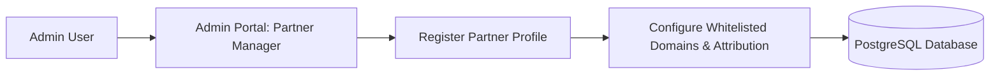
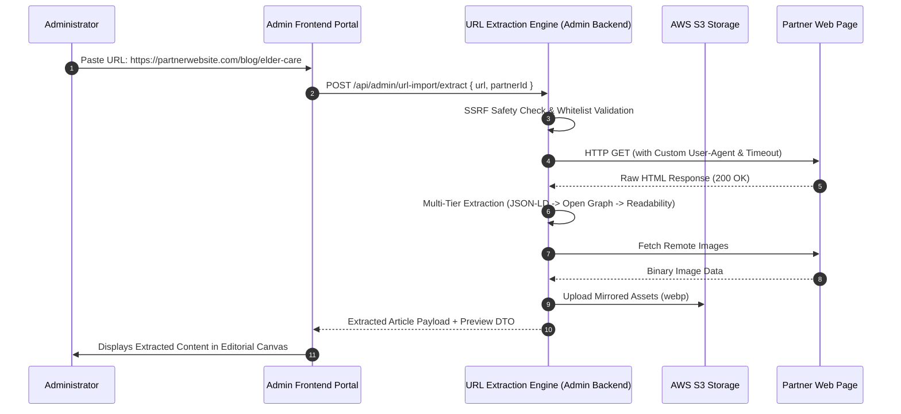
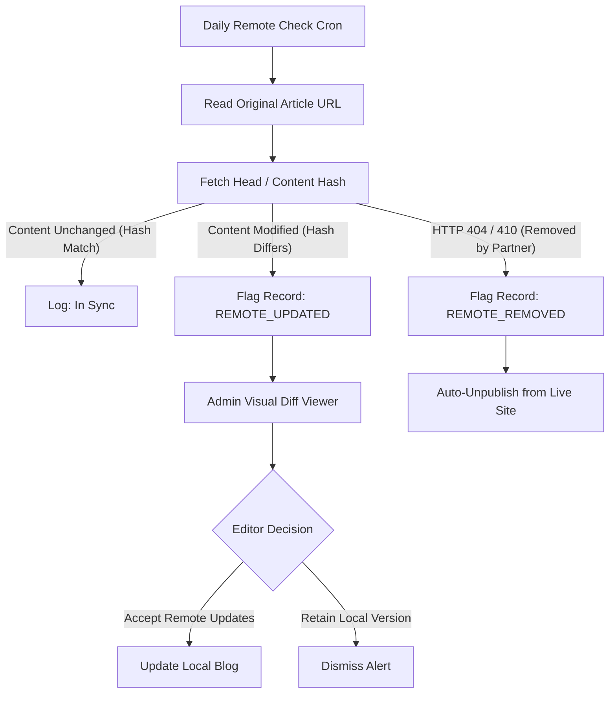
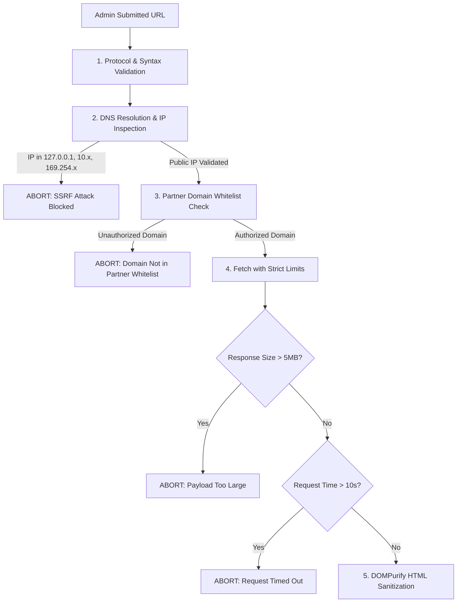

# Technical Implementation Plan 2: URL-Based Partner Content Import

> **Document Type:** Technical Architecture & Implementation Specification  
> **Target Platform:** MaiHoonNa (MHN) Senior Care Ecosystem  
> **Scope:** Admin Portal, Main API (`apps/api`), Admin Backend (`apps/admin-backend`), Database (`@maihoonna/database`), Public Website (`apps/website`), and Mobile App (`apps/mobile-app`)  
> **Status:** Draft for Technical Review & Architecture Approval  

---

## Executive Summary

This document specifies the end-to-end architecture and implementation plan for importing content from partner websites **using article URLs alone**, eliminating the requirement for partners to build, expose, or maintain external REST/GraphQL APIs.

In many senior care partnerships (e.g., local medical associations, specialized memory clinics, elder nutritionists, non-profit geriatric trusts), partners lack engineering teams or technical infrastructure to provide webhooks or APIs. With this URL-based import system, an administrator can simply paste a partner's article URL (e.g., `https://partnerwebsite.com/blog/elder-care`) into the MaiHoonNa Admin Portal. A robust server-side extraction engine retrieves the raw document, parses structured schema (JSON-LD, Open Graph) and clean article text (via Mozilla Readability), downloads and ingests media assets into MaiHoonNa’s private S3 bucket, and presents the content in an editorial workbench for approval and native publication at `maihoonna.com/blog/elder-care`.

---

## Section A: Existing Project Architecture Analysis

The URL-based import engine integrates directly into the existing MaiHoonNa infrastructure:

| Existing System | Repository Location | How Plan 2 Leverages It |
|---|---|---|
| **Admin Backend** | `apps/admin-backend` (Node.js Express + Prisma) | Hosts the URL extraction controller, SSRF validation filter, HTML sanitization, and manual editorial endpoints (`/api/admin/url-import`). |
| **Database** | `packages/database/prisma/schema.prisma` | Stores URL import records, extraction snapshots, visual diffs, and links approved articles directly to the existing `community_blogs` table. |
| **Media & Assets Storage** | AWS S3 via `apps/admin-backend/services/storage` | External images embedded in partner URLs are automatically parsed, safely fetched, converted to modern `.webp`, and persisted in our private S3 bucket under `partners/url-imports/`. |
| **Admin Frontend** | `apps/admin-frontend` (React 18 + Tailwind v4 + Radix) | New "URL Content Importer" modal and side-by-side extraction review editor integrated into `DashboardLayout.tsx`. |
| **Public Delivery (Web)** | `apps/website` (React SPA) | Renders imported articles at `maihoonna.com/blog/:slug` with full canonical SEO tags and partner attribution. |
| **Public Delivery (Mobile)** | `apps/mobile-app` (Expo React Native) | Reuses the existing `app/(community)/blogs/[id].tsx` screen with zero code duplication. |

---

## 1. Partner Management (URL-Based)

In this model, partner registration is lightweight and non-technical.



### 1.1 Partner Configuration Attributes
1. **Basic Identity:** Organization Name, Contact Person, Email, Official Website URL (e.g., `https://silverinnings.com`).
2. **Whitelisted Domains & Base Paths:**
   - Limits URL imports strictly to authorized partner domains (e.g., `silverinnings.com`, `blog.silverinnings.com`).
   - Prevents accidental or unauthorized imports from third-party or competitor websites.
3. **Attribution & Licensing Rules:**
   - Default Attribution Byline: *"Published in collaboration with Silver Innings Senior Living."*
   - Canonical URL Strategy:
     - `ORIGINAL_SOURCE` (Points `rel="canonical"` to the partner's exact URL).
     - `SELF_CANONICAL` (Sets canonical to `maihoonna.com/blog/:slug` if agreed under co-creation contracts).
   - Partner Status: Active vs. Deactivated (Deactivating a partner provides an instant option to archive all their syndicated articles).

---

## 2. URL Import Functionality & Flow

Administrators can import articles individually or in small batches by URL.



### 2.1 Extraction Inputs & Capabilities
- **Single URL Import:** Admin pastes a URL into a clean modal, selects the associated Partner, and hits `"Extract Content"`.
- **Batch URL Queue:** Admin can paste up to 10 URLs at once. A background job processes each URL sequentially, showing a progress indicator and populating the staging review queue.
- **Auto-Extracted Data Points:**
  - Article Title
  - Meta Description / Excerpt
  - Full Clean Body Content (formatted HTML with headings, paragraphs, lists)
  - Hero / Featured Image
  - Inline Article Images
  - Author Name & Byline
  - Original Publication Date & Last Modified Date
  - Keywords, Tags & Meta Categories
  - Original Canonical URL

---

## 3. Multi-Tier Content Extraction Engine

Extracting clean editorial content from arbitrary web pages is complex due to diverse CMS structures (WordPress, Medium, Substack, custom React/Next.js sites). We employ a resilient **multi-tiered extraction pipeline**.

```mermaid
flowchart TD
    HTML[Raw HTML Ingestion] --> ParseDOM[Load DOM into Cheerio]
    
    subgraph Tier1 [Tier 1: Structured Metadata Engine]
        ParseDOM --> JSONLD[JSON-LD schema.org/Article]
        ParseDOM --> OpenGraph[Open Graph & Twitter Meta Tags]
    end

    subgraph Tier2 [Tier 2: Readability Text Extraction]
        ParseDOM --> CleanDOM[Strip Scripts, Ads, Sidebars, Navs]
        CleanDOM --> MozillaReadability[@mozilla/readability Article Parsing]
    end

    subgraph Tier3 [Tier 3: Asset & Link Normalization]
        MozillaReadability --> ResolveRelative[Convert Relative URLs to Absolute]
        ResolveRelative --> SanitizeHTML[DOMPurify XSS Filter]
        SanitizeHTML --> MirrorImages[Download & Ingest Images to S3]
    end

    Tier1 --> Synthesizer[Metadata Synthesizer & Deduplicator]
    Tier3 --> Synthesizer
    Synthesizer --> StagingRecord[Staging Article Record]
```

### 3.1 Extraction Library Evaluation

| Technology / Library | Purpose in Pipeline | Justification |
|---|---|---|
| **Cheerio** | Fast DOM Parser & Selector Engine | Extremely fast, lightweight server-side jQuery-like DOM traversal. Ideal for metadata extraction, tag cleanup, and relative URL resolution. |
| **`@mozilla/readability`** | Core Body Content Extraction | The battle-tested algorithm powering Firefox Reader View. Strips navigations, sidebars, advertisements, footers, and comment sections while preserving headings, paragraphs, and blockquotes. |
| **`jsdom`** | DOM Environment for Readability | Provides the standard W3C DOM tree required by `@mozilla/readability` in Node.js. |
| **JSON-LD & Schema.org Parser** | Precision Metadata Extraction | Reads `<script type="application/ld+json">`. When available, yields exact author names, publication timestamps, and official hero images with 100% fidelity. |
| **Puppeteer / Playwright** | Optional Headless JS Fallback (Selective) | Only invoked if Cheerio/Readability returns empty content (indicating a client-rendered SPA). Kept disabled by default to minimize memory overhead and execution latency. |

### 3.2 Handling Real-World Web Scraping Challenges

1. **Anti-Scraping & Bot Blocks (Cloudflare, PerimeterX, 403 Forbidden):**
   - **Policy:** MaiHoonNa operates under legitimate, authorized partnerships. We will **not** implement illegal bypasses, CAPTCHA solvers, or rotating proxy swarms.
   - **Engine Behavior:**
     - The scraper uses a transparent, polite `User-Agent`:  
       `Mozilla/5.0 (compatible; MaiHoonNaBot/1.0; +https://maihoonna.com/bot; partner-syndication)`
     - If the partner's server returns a CAPTCHA challenge or HTTP `403 Forbidden`, the engine halts and logs:  
       `EXTRACTION_BLOCKED: Partner server requires whitelisting MaiHoonNa server IP.`
     - **Graceful Fallback:** The admin UI offers a **"Manual Rich-Text Paste"** tab where the editor can copy-paste the text directly into the editor while retaining the partner URL attribution.
2. **JavaScript-Rendered SPAs (React / Vue / Angular):**
   - If initial raw HTML contains no readable article text (`<div id="root"></div>`), the worker flags the extraction as `REQUIRES_HEADLESS_RENDER`.
   - Admin can trigger an on-demand single-page render via a sandboxed Chrome instance with a strict 10-second timeout.
3. **Relative Image & Link Resolution:**
   - Any `` or `<a href="/about">` is automatically converted to absolute URLs (`https://partnerwebsite.com/images/art.jpg`) before media downloading.
4. **Duplicate URL Protection:**
   - The database maintains a unique constraint on `(partnerId, originalArticleUrl)`.
   - Attempting to import an existing URL notifies the admin: *"This URL was already imported on [Date]. Would you like to view existing content or check for remote updates?"*

---

## 4. Admin Content Editor & Publishing Workbench

Once extracted, content is never automatically published to the live platform. It lands in an interactive editorial workbench in `apps/admin-frontend`.

```
┌────────────────────────────────────────────────────────────────────────┐
│ 📝 Review Extracted Article                    [ Save Draft ] [ Approve ]│
├────────────────────────────────────────────────────────────────────────┤
│ URL: https://silverinnings.com/dementia-home-care-tips                 │
│ Partner: Silver Innings • Extracted: Today, 10:15 AM                   │
├──────────────────────────────────┬─────────────────────────────────────┤
│ 📄 EDITORIAL FORM                │ 👁️ LIVE MAIHOONNA PREVIEW          │
│                                  │                                     │
│ Article Title:                   │ [ 🏷️ Dementia Care • 4 min read ]    │
│ [ 10 Practical Dementia Tips ]   │                                     │
│                                  │ 10 Practical Dementia Tips for      │
│ Short Excerpt (SEO Description): │ Family Caregivers at Home           │
│ [ Practical home care guidance..]│                                     │
│                                  │ 🤝 In Partnership with Silver Innings│
│ Category:                        │ Authored by Sailesh Mishra          │
│ [ Memory & Dementia Care ▾ ]     │                                     │
│                                  │ [ S3 Mirrored Hero Image ]          │
│ Author Attribution:              │                                     │
│ [ Sailesh Mishra (SilverInnings)]│ Caring for a parent with memory     │
│                                  │ loss requires patience...           │
│ Featured Image:                  │                                     │
│ [ Replace Image ] [ Crop 16:9 ]  │ ─────────────────────────────────── │
│ (Stored in S3: partners/img.webp)│ ℹ️ Original Source: Silver Innings  │
│                                  │ [ Read Original Article ↗ ]         │
│ Tags:                            │                                     │
│ [ Dementia ] [ Home Care ]       │                                     │
└──────────────────────────────────┴─────────────────────────────────────┘
```

### 4.1 Editorial Controls
* **Live Side-by-Side Preview:** Shows exactly how the article will render on `maihoonna.com` and the mobile app before publishing.
* **Inline Image Management:**
  - Lists all inline images extracted from the body.
  - Allows editors to remove unnecessary decorative images or advertisements that were part of the partner's page layout.
* **Content Scrubbing:** Editors can fix formatting glitches, remove partner-specific internal links (e.g., *"Click here to subscribe to our newsletter"*), and format callout quotes.
* **Publishing Actions:**
  - **Save Draft:** Stores edits in `PartnerUrlImport` without publishing.
  - **Publish Now:** Migrates the record into `Blog` (`community_blogs`) with status `published`.
  - **Schedule:** Sets scheduled release timestamp.

---

## 5. Website & Mobile App Native Presentation

When users visit an imported article, it is displayed inside MaiHoonNa's native template:

```
https://maihoonna.com/blog/dementia-home-care-tips
```

### 5.1 Presentation Details
* **Desktop / Web Layout (`apps/website`):**
  - MaiHoonNa Header with navigation (Home, Services, Saathi, Legacy, Login).
  - Clean readability-optimized typography (Poppins 18px body font, 1.7 line height, `#1F2937` charcoal text on `#FAF3EB` background).
  - Prominent **Partner Collaboration Card** at the top.
  - Standard MaiHoonNa Footer with legal links and emergency helpline.
* **Mobile App Screen (`apps/mobile-app`):**
  - Rendered in native React Native views (`apps/mobile-app/app/(community)/blogs/[id].tsx`).
  - Font scaling toggles for seniors (1.0x, 1.2x, 1.4x).
  - Native bookmark and social sharing support.

### 5.2 SEO & Canonical URLs
* **Canonical Header:**
  ```html
  <link rel="canonical" href="https://silverinnings.com/dementia-home-care-tips" />
  ```
  *This ensures MaiHoonNa avoids Google duplicate content penalties while passing legitimate domain authority to the partner as agreed.*
* **Schema.org NewsArticle Metadata:**
  Identifies MaiHoonNa as the publisher and the partner as the author/syndicator (`isBasedOn: "https://silverinnings.com/..."`).

---

## 6. Content Update & Remote Lifecycle Management

Partner websites may edit, update, or remove articles over time. The engine provides ongoing lifecycle governance.



### 6.1 Change Detection via Cryptographic Hashing
1. **Remote SHA-256 Hashing:**
   - Every imported article stores `extractedContentHash = sha256(cleanArticleBody)`.
   - A low-priority background worker runs weekly or on-demand: fetches the target URL, extracts the clean text, and computes the new hash.
   - If the hash differs: Generates a visual diff (added text in green, removed in red) and notifies the editorial team.
2. **Handling Partner Deletion / 404:**
   - If a partner removes an article or sets it to private, the check detects HTTP `404 Not Found` or `410 Gone`.
   - The article in MaiHoonNa’s database transitions to `status: archived` (unpublished) within 24 hours to honor syndication terms.
3. **Import Audit Trail:**
   - All historical imports, re-extractions, and manual edits are recorded in `PartnerUrlImportHistory`.

---

## 7. Security & Legal Considerations

Server-side URL fetching is a high-risk vector if not architected with rigorous defense-in-depth.



### 7.1 Server-Side Request Forgery (SSRF) Defense
1. **Protocol Restriction:** Only `https://` is permitted (`http://`, `file://`, `ftp://`, `gopher://` are rejected).
2. **DNS & IP Blacklisting (RFC 1918 & Cloud Metadata):**
   - The backend performs DNS lookup on the target domain before initiating HTTP requests.
   - Blocks:
     - Loopback addresses (`127.0.0.0/8`, `::1`).
     - Private network ranges (`10.0.0.0/8`, `172.16.0.0/12`, `192.168.0.0/16`).
     - Link-local and cloud metadata endpoints (`169.254.169.254` AWS IMDSv1/v2).
3. **Redirect Protection:**
   - Maximum 3 HTTP redirects allowed.
   - Each redirect hop re-executes the full DNS and IP validation check to prevent DNS rebinding attacks.

### 7.2 HTML & Script Sanitization
- Even trusted partner pages could be compromised. All extracted HTML is sanitized through **DOMPurify** with a strict allowlist:
  - Allowed Tags: `p`, `h1`, `h2`, `h3`, `h4`, `b`, `i`, `strong`, `em`, `ul`, `ol`, `li`, `blockquote`, `img`, `table`, `tr`, `td`, `th`.
  - Disallowed Tags: `script`, `iframe`, `object`, `embed`, `form`, `input`, `style`, `link`.
  - Disallowed Attributes: `onclick`, `onload`, `onerror`, `style`.

### 7.3 Legal & Copyright Governance
- **Explicit Agreement Prerequisite:**
  - In the Admin UI, importing from a partner requires confirming:
    `[✓] Verified: We have written syndication/partnership permission to republish content from this partner.`
- **Attribution Retention:**
  - Automated inclusion of the canonical link and partner source byline prevents copyright infringement disputes.

---

## Section B: Database Design (Prisma Schema Extensions)

Add the following models into `packages/database/prisma/schema.prisma`:

```prisma
// ─── URL-BASED PARTNER CONTENT IMPORT DOMAIN ───────────────────────────────

enum UrlImportStatus {
  EXTRACTED
  DRAFT_SAVED
  APPROVED
  REJECTED
  REMOTE_UPDATED
  REMOTE_REMOVED
}

model PartnerUrlSource {
  id                  String             @id @default(uuid())
  name                String             // e.g. "Silver Innings Senior Care"
  slug                String             @unique
  primaryDomain       String             // e.g. "silverinnings.com"
  allowedDomains      String[]           @default([]) // e.g. ["silverinnings.com", "blog.silverinnings.com"]
  logoStorageKey      String?            // S3 storage key
  contactEmail        String?
  defaultAttribution  String?            @db.Text
  canonicalStrategy   CanonicalStrategy  @default(ORIGINAL_SOURCE)
  isActive            Boolean            @default(true)
  checkUpdatesDaily   Boolean            @default(false)
  createdAt           DateTime           @default(now())
  updatedAt           DateTime           @updatedAt

  importedArticles    PartnerUrlImport[]

  @@map("partner_url_sources")
}

model PartnerUrlImport {
  id                   String            @id @default(uuid())
  partnerSourceId      String
  sourceUrl            String            @unique // Unique original URL
  
  // Extracted Metadata
  extractedTitle       String
  extractedExcerpt     String            @db.VarChar(1000)
  extractedContentHtml String            @db.Text
  contentHash          String            // SHA-256 to detect remote changes
  
  // Editorial Overrides
  editedTitle          String?
  editedExcerpt        String?           @db.VarChar(1000)
  editedContentHtml    String?           @db.Text
  
  // Taxonomy & Author
  extractedAuthorName  String?
  mappedAuthorId       String?
  extractedCategory    String?
  mappedCategoryId     String?
  tags                 String[]          @default([])
  
  // Media Assets
  sourceHeroImageUrl   String?           @db.Text
  mirroredHeroImageKey String?           // Stored in our AWS S3 bucket
  inlineImageKeys      String[]          @default([]) // Mirrored inline images
  
  // Status & Publication
  status               UrlImportStatus   @default(EXTRACTED)
  publishedBlogId      String?           @unique // Linked to community_blogs
  importedById         String
  reviewedById         String?
  lastCheckedRemoteAt  DateTime?
  remoteCheckResult    String?           // OK | MODIFIED | NOT_FOUND | ERROR
  createdAt            DateTime          @default(now())
  updatedAt            DateTime          @updatedAt

  partnerSource        PartnerUrlSource  @relation(fields: [partnerSourceId], references: [id], onDelete: Cascade)
  importedBy           User              @relation("UrlImportUser", fields: [importedById], references: [id])
  reviewedBy           User?             @relation("UrlReviewUser", fields: [reviewedById], references: [id])
  mappedAuthor         ContentAuthor?    @relation(fields: [mappedAuthorId], references: [id])
  mappedCategory       ContentCategory?  @relation(fields: [mappedCategoryId], references: [id])
  publishedBlog        Blog?             @relation("UrlImportPublishedBlog", fields: [publishedBlogId], references: [id])
  history              PartnerUrlImportHistory[]

  @@index([partnerSourceId, status])
  @@index([contentHash])
  @@map("partner_url_imports")
}

model PartnerUrlImportHistory {
  id                   String            @id @default(uuid())
  urlImportId          String
  action               String            // EXTRACT | EDIT | APPROVE | REMOTE_CHANGE_DETECTED | UNPUBLISH
  contentHashBefore    String?
  contentHashAfter     String?
  diffSummary          String?           @db.Text
  performedById        String?
  createdAt            DateTime          @default(now())

  urlImport            PartnerUrlImport  @relation(fields: [urlImportId], references: [id], onDelete: Cascade)
  performedBy          User?             @relation(fields: [performedById], references: [id])

  @@index([urlImportId])
  @@map("partner_url_import_history")
}
```

---

## Section C: Admin Panel UI/UX Specifications

### Required Screens & User Flow

```
1. Admin Navigates to: /community/url-import
2. Clicks "+ Import Article from URL"
3. Modal Appears:
   - Selects Partner Source: [ Silver Innings ▾ ]
   - Pastes Target URL: [ https://silverinnings.com/blog/elder-care ]
   - Checkbox: [✓] Whitelist domain verified
   - Clicks: "Extract Content"
4. Spinner shows: "Analyzing page structure & downloading media..." (2–3 sec)
5. Opens Side-by-Side Editorial Workbench:
   - Left: Extracted fields (editable)
   - Right: Real-time MaiHoonNa preview
6. Admin reviews text, selects Category [ Wellness & Health ], confirms Author.
7. Clicks "Approve & Publish to MaiHoonNa".
8. Article immediately live at: maihoonna.com/blog/elder-care
```

### Important UI States
* **Extraction Error State:** Clear diagnosis card (*"Extraction Incomplete: The partner page is protected by Cloudflare. Use the Manual Content Paste fallback or whitelist our server IP"*).
* **Remote Change Warning:** Amber banner in the import list indicating the partner has updated the article on their site, with a one-click *"View Diff & Update"* action.
* **Remote 404 Alert:** Red badge indicating the partner removed the original article, prompting immediate unpublish.

---

## Section D: Frontend & Mobile App Integration

- **Website (`apps/website`):**
  Uses the exact same `/blog` catalog and `/blog/:slug` reader as Plan 1. The frontend does not care whether an article originated from an API or a URL import—it simply displays the published `Blog` entity with its associated partner attribution.
- **Mobile Application (`apps/mobile-app`):**
  Renders identically inside `app/(community)/blogs/[id].tsx` with full offline caching and senior-friendly font scaling.

---

## Section E: Implementation Roadmap & Dependencies

| Phase | Milestone / Tasks | Est. Complexity | Dependencies |
|---|---|---|---|
| **Phase 1: Extraction Engine & Security** | 1. Implement Cheerio + `@mozilla/readability` + `jsdom` parser.<br>2. Build DNS-lookup SSRF firewall and private IP filter.<br>3. Implement DOMPurify sanitization rules.<br>4. Build S3 image streaming & webp converter. | **High** | AWS S3 access, Node.js packages. |
| **Phase 2: Database & Backend Endpoints** | 1. Add Prisma models for `PartnerUrlSource`, `PartnerUrlImport`.<br>2. Build `/api/admin/url-import/extract` and `/publish` routes.<br>3. Build duplicate URL check and SHA-256 hash generator. | **Medium** | Database sync, Phase 1 engine. |
| **Phase 3: Admin Editorial Workbench UI** | 1. Create URL Import modal with single/batch tabs.<br>2. Build Side-by-Side Extracted Article Editor with live preview.<br>3. Build visual diff viewer for remote updates. | **Medium** | Admin frontend components. |
| **Phase 4: Remote Update & 404 Monitor** | 1. Build Redis cron worker to periodically check remote article hashes.<br>2. Implement auto-archive logic on remote 404 responses. | **Medium** | Redis connection. |
| **Phase 5: Quality Assurance & Legal Audit** | 1. Test extraction across 20+ real-world partner formats (WordPress, Ghost, Medium, custom HTML).<br>2. Verify canonical SEO tags in Google Search Console test tools. | **Low** | Deployed staging environment. |

### Technical Risks & Mitigations
* **Risk: Target website blocks scraper via Cloudflare or CAPTCHA.**  
  *Mitigation:* Clean, polite User-Agent, transparent communication with partner to whitelist MaiHoonNa server IP, and immediate fallback to manual rich-text pasting.
* **Risk: Fragile HTML structure causing missing body paragraphs.**  
  *Mitigation:* Mozilla Readability handles 90%+ of editorial layouts; side-by-side admin editor guarantees human oversight before anything goes live.
* **Risk: Malicious external links or tracking pixels embedded in partner HTML.**  
  *Mitigation:* Strict DOMPurify sanitization strips all scripts, tracking pixels, and unauthorized external iframes.

